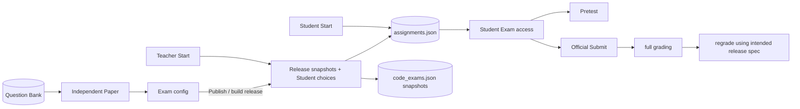

# Kiến trúc hiện tại

> Reconciled against the source tree on 2026-11-22. This is an implementation map, not a test, capacity, security, or deployment certification. See [documentation index](README.md) for the current project footprint and historical reports.

## 1. Thành phần

| Lớp | Trách nhiệm |
|---|---|
| `run_server.py` → `app.main.main()` | Entry point; `Handler` dispatch HTTP routes, auth, templates và responses. |
| `app/config.py`, `app/storage.py` | Paths/host/port; JSON/JSONL, atomic file replacement, process-local lock. |
| `app/security.py` | Session cookie, token hashing, role checks, last_seen, logout. |
| `app/accounts.py`, `app/setup_admin.py`, `app/configure_admin.py` | Account import and administrator setup flows. |
| `app/questions.py`, `static/js/questions.js` | Question schema/lifecycle/revisions; Teacher editor/import/export/validation. |
| `app/practice.py`, `static/js/student-practice.js` | Eligibility, safe Student projection, catalog/progress, visible-only Practice Run. |
| `app/papers.py`, `static/js/code-papers.js` | Independent Paper schema v2, legacy reference resolution, Paper CRUD/preview. |
| `app/general_exams.py`, `static/js/exams.js` | Exam configuration, Common/Random paper selection, release, assignment, lifecycle. |
| `app/exams.py` | File Exam distribution/assignment and legacy/global exam session behavior. |
| `app/code_exams.py` | Release-scoped Code Exam snapshots, Student access, Pretest, Submit, grading/regrade. |
| `app/exam_completion.py` | Server-side code draft checkpoints, manual/automatic attempt finalization, results summary. |
| `app/exam_monitoring.py`, `static/js/exam-telemetry.js`, `static/js/exam-entry.js`, `static/js/practice-lock.js` | Active-attempt telemetry snapshots/events, Student entry/fullscreen gates, Practice lock. |
| `app/code_runner.py`, `app/java_runner.py`, `app/grading.py`, `app/windows_job.py` | STDIO/Reflection execution, result validation/aggregation and Windows process controls. |
| Templates/static JS | Jinja-rendered pages and browser requests/polling/editor state. |

## 2. Persistence boundaries

| File/group | Nội dung |
|---|---|
| `questions.json` | Question Bank content, lifecycle, server-managed validation/revision data. |
| `practice_progress.json` | Student-keyed Practice progress/result/current attempt; editor source drafts live in browser storage. |
| `papers.json` | Independent schema v2 Papers plus retained legacy versioned records. |
| `exams.json` | Exam configuration and release data, including persisted selection/assignment information. |
| `code_exams.json` | Code Exam records and release-scoped question snapshots. |
| `code_attempts.json` | Server-received code drafts and code-exam finalization state. |
| `assignments.json` | Student release/Paper assignment, start/deadline/status. |
| `code_submissions.json`, `submissions.json` | Code result/submission records and uploaded file metadata/payload relationship. |
| `sessions.json` | Session entries keyed by token hash, presence fields and current active-attempt telemetry snapshot. |
| `exam_monitoring.json` | Per-Student/per-release event history, counters, and sequence numbers. |

Optional fields differ across legacy and current shapes. Never reinterpret historical content from current Question/Paper state or flatten legacy records.

## 3. Data flows

### Question → Practice

```mermaid
flowchart LR
  TE[Teacher Question Editor] -->|JSON / form| API[Question API]
  API --> QV[questions._validate_question]
  QV --> Q[(questions.json)]
  Q --> EL[Practice eligibility + safe projection]
  EL --> ST[Student Library]
  ST -->|revision, attempt, source| PR[practice.run_practice]
  PR -->|visible_only| RUN[shared Runner]
  RUN --> RES[normalized visible result]
  RES --> PP[(practice_progress.json)]
```

### Paper → Exam Release → Student

## 4. Detailed execution paths

### 4.1 Question create/import/validate/persist
1. `static/js/questions.js::importSpec()` parses JSON client-side, removes fields in `SERVER_OWNED`, then loads editable draft state. `exportSpec()` exports editor payload; this does not mean every server field is import-owned.
2. `POST /api/admin/questions` and update routes in `app/main.py` call `app/questions.py::_validate_question()`. Backend validates allowed language/grading modes, types, execution config, nested checks/tests and sizes.
3. `create_question()` initializes server-owned lifecycle/revision metadata and writes to `questions.json`; update/publish paths enforce current state/revision. Candidate validation/publish uses code-exam sample validation routes.

### 4.2 Practice Question → Run → progress
- Student routes: GET `/api/student/practice/questions`, question detail, progress and run-status; POST `/api/student/practice/run`; update/delete progress routes in `app/main.py`.
- `is_practice_eligible()` requires published, enabled and valid `practice_revision`; `practice_public_projection()` allowlists Student-visible fields.
- `run_practice()` validates current revision/attempt, protects mutation under storage transaction, guards duplicate active Run, calls `execute_question(..., visible_only=True, workspace_parent=...)` and persists progress/result.
- `student-practice.js` stores source drafts locally; server progress and result are separate from source autosave.

### 4.3 Paper → Release snapshot
- Paper APIs are under `/api/admin/papers`; service in `app/papers.py`. Schema v2 uses independent Paper ID/revision/status. Legacy `paper_id` + explicit `paper_version_id` remain supported.
- `resolve_paper_reference()` resolves new `{paper_id}` vs explicit legacy pair; it never guesses a version ID.
- `static/js/exams.js` sends Code distribution mode and Paper refs. Draft/distributed-before-activity editor supports Common/Random selection; Common requires one Paper, Random selects from an eligible pool.
- `general_exams._build_release()` creates persisted release selection/snapshot data; `_apply_release()` applies pre-start assignment map at Teacher Start. Pre-start updates synchronize relevant assignment state. `expected_revision` protects stale writes; Student activity blocks edits that could rewrite history.
- Release-scoped code exams retain question snapshots. Paper changes affect later release only; Paper-release regrade rejects `use_latest_spec`.

### 4.4 Student Start → Pretest → Submit → Grading
1. Publish creates visibility/release; Teacher Start is a separate action.
2. Student shell `student.js` POSTs `/api/student/start`; backend `exams.start_exam()` checks Teacher state, assignment/release and password, then writes Student `started_at`, deadline, status and audit.
3. `student-code.js` loads `GET /api/student/code-exam`; `_active_context()` rechecks release, assignment, deadline and state.
4. Pretest follows `allow_pretest` settings. Official per-question/exam submit uses release snapshot, full configured checks and persisted `code_submissions.json`.
5. Regrade verifies ended/completed state and uses Paper release snapshot; ZIP/file Exam has separate `/api/student/exam` and `/api/student/submit` routes.

### 4.5 Student heartbeat → telemetry → Teacher Monitoring
- `student.js::heartbeat()` runs immediately and every 10s, polls `GET /api/student/status`, and sends telemetry snapshots only while the server reports an active attempt. Focus/blur/visibility events may submit attempt events through `exam-telemetry.js`.
- `updateTabs()` tracks recent page IDs in origin-scoped `localStorage["css-exam-tabs"]`; it cannot inventory every browser tab.
- Student telemetry is accepted only for an active attempt and carries a release identity. `POST /api/student/telemetry/event` records supported event types in `exam_monitoring.json`, deduplicated by event ID and sequenced per Student/release.
- `monitoring_snapshot()` combines current session, assignment and submission data with active-attempt event counters/history cursor. `admin.js` polls `GET /api/admin/monitor` every 5s and retrieves event pages when the sequence advances.
- Student entry supports the tab precheck and fullscreen gate; Practice pages enforce a per-Student active-exam lock. Presence/session freshness remains distinct from attempt-scoped monitoring.

Implementation details and remaining limitations are in [Known Issues](KNOWN_ISSUES.md). The [Telemetry Audit](TELEMETRY_ARCHITECTURE_AUDIT.md) is a historical pre-implementation report.

## 5. Authentication and persistence

`security.get_session()` validates cookie by hashing token to lookup key in `sessions.json`, enforces expiration and updates `last_seen`. Login revokes prior Student session for same ID; logout removes current session.

`storage.py` offers atomic replacement per file and a process-local reentrant lock; `transaction()` only protects call sequences that participate. It is not a multi-process lock or multi-file atomic commit. Inspect each workflow's lock boundary before making concurrency claims. Runtime JSON is operational data, not disposable fixtures.

## 6. Shared Runner / Grader

- `code_runner.run_stdio()`: Java/Python STDIO, separate tests, supports `visible_only` and `workspace_parent`.
- `java_runner.run_reflection_judge()`: Reflection request/spec validation, compile and judge protocol.
- `code_exams.execute_question()` chooses execution mode. Practice invokes it visible-only; Official grading uses full configured checks.
- `grading.py` validates and aggregates results, rather than running student processes.
- Windows Job Objects provide process/resource lifecycle controls; do not treat them alone as proof of filesystem/network sandbox isolation.

## 7. Navigation and verification

Key tests: `test_practice.py`, `test_practice_workspace.js`, `test_question_concurrency.py`, `test_papers.py`, `test_paper_distribution.py`, `test_exam_selector.js`, `test_code_api.py`, `test_grading.py`, `test_java_runner.py`, `test_reflection_judge.py`, `test_core.py`. Check `rg --files tests` for current inventory. This documentation task did not run tests.

## 8. Proposed / under discussion

Attempt-scoped telemetry, persistent event history, tab precheck, fullscreen entry gate, Practice lock and server-side code-exam completion are present in the current source. Their presence does not certify browser acceptance, production readiness, or a particular deployment. Proposals not implemented remain out of scope unless separately authorized; see [Exam Monitoring implementation plan](EXAM_MONITORING_IMPLEMENTATION_PLAN.md) and [Known Issues](KNOWN_ISSUES.md).
