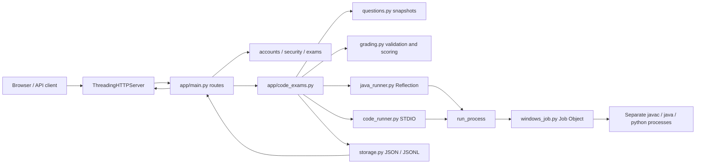
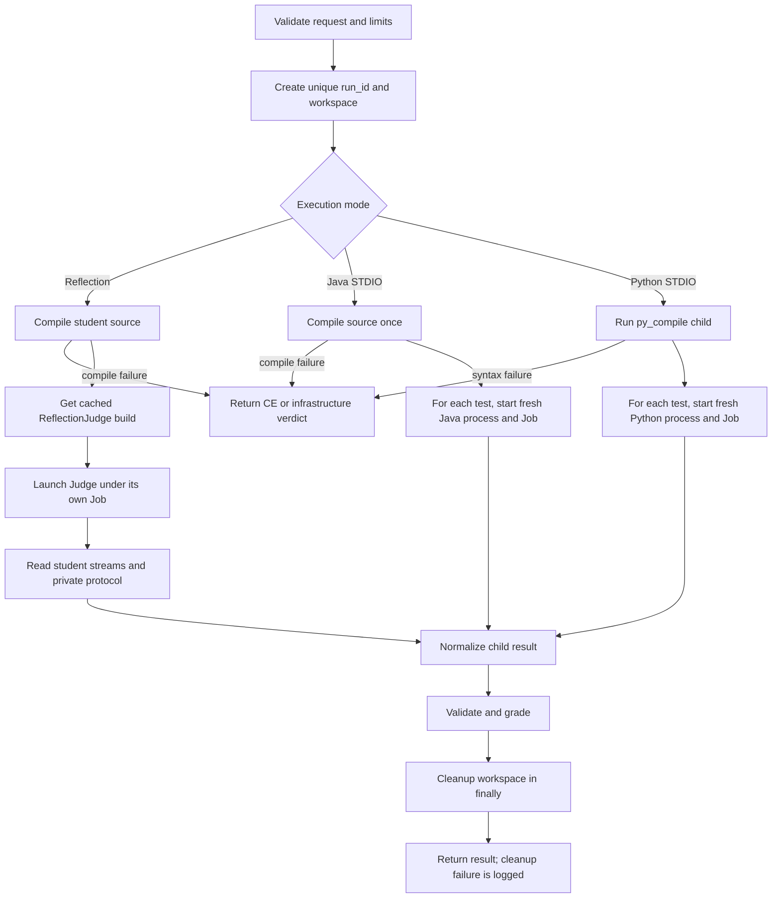

# Tài liệu bàn giao kỹ thuật: Judge/Execution

> Tài liệu này mô tả checkout tại commit `3176910b3a84334925bfb9011f62025a03eaa1fd`, được rà soát ngày 03-11-2026. Hành vi trong source code là căn cứ chính; README và SPECIFICATION còn một số nội dung cũ được ghi rõ ở dưới.

## 1. Mục đích và trạng thái tổng quan

Tài liệu bàn giao cấu trúc, API, quy trình chạy code, giới hạn tài nguyên, kết quả, kiểm thử và các giới hạn bảo mật của Judge/Execution trong ClassroomSubmissionServerSystem. Không có thay đổi source trong đợt rà soát này; tài liệu này là file duy nhất được thêm.

Trạng thái dùng trong tài liệu:

| Trạng thái | Ý nghĩa |
| --- | --- |
| IMPLEMENTED | Có đường chạy hiện tại trong source và có test phù hợp. |
| PARTIALLY IMPLEMENTED | Có một phần hoặc chỉ áp dụng trong các điều kiện cụ thể. |
| NOT IMPLEMENTED | Không tìm thấy triển khai trong phạm vi đã đọc. |
| NOT VERIFIED | Không có bằng chứng runtime phù hợp trong lần rà soát này. |
| DEFERRED | Được để lại cho giai đoạn sau hoặc ngoài phạm vi hiện tại. |

| Hạng mục | Trạng thái | Ghi chú |
| --- | --- | --- |
| Java Reflection | IMPLEMENTED | Compile, cache judge, kiểm tra reflection/behavior, JSON result. |
| Java STDIO | IMPLEMENTED | Compile một lần cho một lần chấm; mỗi test chạy process riêng. |
| Python STDIO | IMPLEMENTED | Kiểm tra cú pháp trong process riêng; mỗi test chạy Python executable riêng. |
| Windows Job Object | IMPLEMENTED | Giới hạn process, commit memory, kill-on-close; Windows-specific. |
| Filesystem/network sandbox | NOT IMPLEMENTED | Job Object không chặn quyền filesystem hay network của tài khoản chạy server. |
| Process-per-reflection-check | DEFERRED | Mỗi check có classloader/object riêng; vẫn cùng JVM và có thể chia sẻ JVM-wide state. |
| Linux/macOS execution | NOT VERIFIED | Job Object là điều kiện bắt buộc cho execution hiện tại. |
| Giao diện người dùng mới cho code exam | PARTIALLY IMPLEMENTED | Server/API tồn tại; phạm vi tài liệu này không xác nhận đầy đủ UI. |

## 2. Kiến trúc hệ thống

Ứng dụng HTTP dùng `ThreadingHTTPServer` của Python standard library; route ở `app/main.py` gọi các module nghiệp vụ. Dữ liệu cấu hình, exam, submission và audit lưu qua JSON/JSONL trong `app/storage.py`. Jinja2 là dependency ứng dụng; execution không dùng framework web hoặc thư viện sandbox ngoài.



Execution child không chạy trong Python server process. Server tạo process riêng; Windows Job Object được thiết lập trước khi process được resume. Đây là process/resource containment, không phải sandbox đầy đủ.

## 3. Luồng request và call graph

```mermaid
sequenceDiagram
    participant Client as Browser/API client
    participant HTTP as ThreadingHTTPServer / main.py
    participant CE as code_exams.py
    participant Runner as java_runner.py hoặc code_runner.py
    participant Job as windows_job.py
    participant Child as javac/java/python
    participant Store as storage.py
    Client->>HTTP: POST /api/student/code/run hoặc /submit
    HTTP->>CE: xác thực session, parse JSON, gọi nghiệp vụ
    CE->>CE: kiểm tra exam lifecycle, deadline, quyền chạy
    CE->>Runner: source + snapshot question + visible/all cases
    Runner->>Job: tạo process suspended, cấu hình và assign Job
    Job->>Child: resume sau khi assign thành công
    Child-->>Runner: exit, stdout/stderr, protocol/result
    Runner-->>CE: JudgeResult / test results / verdict
    CE->>CE: grading validation; pretest không chấm điểm cuối
    opt Submit
        CE->>Store: lưu code submission, score và metadata
        CE->>Store: audit metadata; không ghi full source vào audit
    end
    CE-->>HTTP: response JSON
    HTTP-->>Client: HTTP response
```

Admin routes quản lý question bank, publish mẫu và tạo code exam. Student run/submit được chặn theo session/role và vòng đời exam. Route ZIP cũ `/api/student/submit` nằm riêng và tiếp tục dùng luồng submission hiện có.

## 4. Quyền sở hữu module và điểm mở rộng

| File | Trách nhiệm hiện tại | Caller/chủ sở hữu | Thay đổi phù hợp khi mở rộng |
| --- | --- | --- | --- |
| `app/main.py` | HTTP routes, xác thực route, request/response JSON | HTTP server | Chỉ đổi khi API hoặc route thay đổi; giữ pattern hiện có. |
| `app/code_exams.py` | Snapshot, lifecycle, pretest/submit, semaphore, persistence/audit | `main.py` | Thay đổi orchestration/exam behavior tại đây. |
| `app/questions.py` | Validate và quản lý question bank | `code_exams.py` | Thay đổi schema/spec câu hỏi và giới hạn nhập liệu. |
| `app/java_runner.py` | Workspace, JDK, compile, process capture, ReflectionJudge cache/launch | `code_exams.py` | Reflection/process contracts; không tính điểm exam ở đây. |
| `app/code_runner.py` | Java/Python STDIO, comparator và per-test result | `code_exams.py` | STDIO semantics; không thay comparator nếu không có test cụ thể. |
| `app/windows_job.py` | ctypes Windows Job Object, process/handle lifecycle | Hai runner | Thay đổi containment phải giữ fail-closed và Windows integration tests. |
| `app/grading.py` | Validate result và tính điểm check/test/question/exam | `code_exams.py` | Score contract; không chạy process. |
| `app/storage.py` | JSON/JSONL persistence, locking/update, audit | Business modules | Dữ liệu và audit; không đưa execution logic vào đây. |
| `judge/ReflectionJudge.java` | Parse spec, load student classes, checks, protocol output | `java_runner.py` | Reflection behavior/protocol; thêm test Java đồng thời. |
| `tests/test_*runner*.py` | Runner contracts, integration, failure/recovery | unittest | Cập nhật cùng thay đổi contract. |
| `tests/test_windows_job.py` | Windows Job Object integration/validation | unittest | Windows-only semantics; không giả lập API bằng test rỗng. |
| `tests/test_grading.py` | Result validation và scoring | unittest | Boundary execution-score. |
| `tests/test_code_api.py` | Route, permission, lifecycle và storage integration | unittest | API compatibility/regression. |

## 5. Các execution mode

| Mode | Trạng thái | Cách chạy | Result chính |
| --- | --- | --- | --- |
| Java Reflection | IMPLEMENTED | Compile student source; chạy ReflectionJudge trong JVM riêng; student class được nạp từ output directory. | `JudgeResult`, check details và verdict. |
| Java STDIO | IMPLEMENTED | `javac` một lần trong run; mỗi test tạo process Java mới, cùng compiled output được materialize riêng cho test. | Per-test verdict, output, duration, score. |
| Python STDIO | IMPLEMENTED | Python executable tuyệt đối; py_compile trong child process; sau đó mỗi test chạy process mới. | Per-test verdict, output, duration, score. |
| Java class compile-only | PARTIALLY IMPLEMENTED | `compile_java` cung cấp compile result, dùng làm nền cho runners. | `CompileResult`; không tự chấm behavior. |

Question schema chấp nhận các cặp language/mode: `java/reflection`, `java/stdio`, `python/stdio`. Student code không được import vào server process.

## 6. Vòng đời execution và workspace



`RunWorkspace` tạo `run_<uuid>` riêng với `src/`, `out/`, `input/`, `result/`. Mặc định dùng thư mục tạm hệ điều hành dưới `ClassroomSubmissionServer`. Cleanup được gọi khi thoát context/finally; `keep_temp=True` giữ workspace theo yêu cầu debug. Dọn read-only có retry hữu hạn. Nếu cleanup lỗi, lỗi được ghi log và không ghi đè verdict đã có. Các process/job phải được kết thúc trước khi xóa file đang dùng.

## 7. Execution contracts và schema kết quả

### ProcessResult

Trong `app/java_runner.py`, process status là `EXITED`, `TIMEOUT`, `MEMORY_LIMIT`, `OUTPUT_LIMIT`, `START_ERROR`. Kết quả mang exit code, duration, stdout/stderr đã giới hạn, byte count, cờ truncated, `run_id`, error và error category. Đây là kết quả process-level, chưa phải điểm.

### CompileResult

Compile trả trạng thái process cùng `success`, optional verdict, JDK info, expected class file/path existence, captured streams, duration, workspace run id và error/category. `javac` chạy với `-encoding UTF-8 -proc:none`. Compiler exit khác 0 được phân loại `CE`; timeout/resource/infrastructure giữ loại tương ứng. Source package được đặt theo relative source path và class output vào `out/`.

### JudgeResult và Reflection JSON

JudgeResult ở Python chứa verdict, score, total points, checks, run id, duration, error/category và thông tin compile/process liên quan. Judge child giữ schema kết quả đóng băng ở phần cốt lõi:

```json
{
  "score": 0,
  "total_points": 0,
  "checks": [
    {
      "id": "check-id",
      "passed": false,
      "points_earned": 0,
      "expected": null,
      "actual": null,
      "error": null
    }
  ]
}
```

Implementation có thêm metadata failure như `error_category`/`failure_type`/`error` khi cần. Verdict Python không được suy ra bằng cách coi stdout student là JSON. Judge result dùng kênh protocol riêng có giới hạn riêng; stream student stdout/stderr độc lập.

### Per-test và GradingResult

STDIO trả kết quả từng test gồm id/index, verdict, expected/actual output, points, duration và error; các trường hiển thị được lọc theo visibility. `grading.py` xác thực checks/test ids, points, tổng điểm, score, các trường JSON và verdict trước khi tính tổng. Kết quả infrastructure không bị lặng lẽ chuyển thành WA/0. `grade_reflection`, `grade_stdio`, `grade_exam` là các hàm scoring; API response được điều phối ở `code_exams.py`.

## 8. Verdict và phân loại lỗi

| Verdict/category | Ý nghĩa trong hệ thống |
| --- | --- |
| `AC` | Tất cả điều kiện chấm của đơn vị tương ứng đạt. |
| `WA` | Chương trình chạy được nhưng kết quả/check sai. |
| `CE` | Compile Java hoặc kiểm tra cú pháp Python thất bại do source. |
| `TLE` | Timeout compile/runtime theo monotonic deadline. |
| `MLE` | Chỉ khi Windows Job Object cung cấp bằng chứng vượt commit limit. |
| `RE` | Student process kết thúc khác 0 hoặc Reflection student execution kết thúc bất thường. |
| `OLE` | Student stdout/stderr capture vượt output budget. |
| `INVALID_REQUEST` | Request/spec hoặc config truyền vào không hợp lệ. |
| `JDK_NOT_FOUND` | Không chọn được cặp `java`/`javac` của cùng JDK. |
| `JUDGE_INFRA_ERROR` | Job/process/Judge infrastructure không khởi động hoặc không vận hành được. |
| `PROTOCOL_ERROR` | Judge result channel thiếu, sai định dạng hoặc không hợp lệ. |

Non-zero exit trong STDIO là RE dù stdout trùng expected. Timeout và output limit kill Job tree. OOM Java tự thân không đủ để gọi MLE; abnormal exit không tự động đồng nghĩa MLE. Compile timeout hiện đi qua process timeout semantics; compile lỗi cú pháp rõ ràng là CE.

## 9. Configuration và mặc định

Question defaults/validation trong `app/questions.py`:

| Cấu hình | Mặc định | Phạm vi/ý nghĩa |
| --- | --- | --- |
| `time_limit_seconds` | 2 giây | Số dương; tối đa 60 giây. Áp cho test runtime. |
| `memory_limit_mb` | 256 MiB | 16..2048; Java tối thiểu 256 MiB. Áp cho mỗi Job execution. |
| `max_output_bytes` | 65536 bytes | 1024..1 MiB, giới hạn output theo test. |
| `allow_pretest` | true | Bật/tắt pretest; chỉ case visible chạy qua API pretest. |
| `max_pretest_runs` | 20 | 1..1000 lượt theo policy question. |
| Concurrent code runs | 2 | `CSS_MAX_CONCURRENT_CODE_RUNS`, clamp 1..16; lỗi integer quay về 2. Semaphore theo server process. |
| Reflection timeout | 10 giây | Mặc định trong `java_runner.py`; compile timeout riêng 20 giây. |
| Reflection student stdout/stderr | 256 KiB mỗi stream theo mặc định | Có thể truyền limit riêng; không dùng chung protocol budget. |
| Judge protocol | 1 MiB | Giới hạn riêng với student output. |
| Java compile output | 64 KiB | Giới hạn stdout/stderr compile qua runner. |
| STDIO test timeout | 2 giây | `DEFAULT_TEST_TIMEOUT_SECONDS`. |
| STDIO compile timeout | 20 giây | `DEFAULT_COMPILE_TIMEOUT_SECONDS`. |
| STDIO stdout/stderr | 64 KiB | `DEFAULT_MAX_OUTPUT_BYTES`. |
| Source | 1 MiB | Kiểm tra request/question runner. |
| Test input/expected | 1 MiB mỗi nội dung; 16 MiB aggregate | Giới hạn request validation. |

`JAVA_HOME` nếu được đặt phải trỏ đến bin directory có cả `java` và `javac`. Nếu không, tools được resolve qua PATH; nếu `java`/`javac` resolve đến bin directory khác nhau, runner báo JDK infrastructure error thay vì trộn JDK. Java heap `-Xmx` lấy tối đa một nửa budget commit hữu hiệu, để phần còn lại cho native JVM, harness, metadata, stack và code cache. Giá trị không phải tổng memory.

## 10. Process monitoring và Windows Job Object

`windows_job.py` dùng ctypes/Windows API, không dùng pywin32. Mỗi execution process có Job Object riêng. Process được tạo ở trạng thái suspended, cấu hình Job, assign process, rồi mới ResumeThread. Nếu create/configure/assign thất bại thì process không được chạy unrestricted. Kill-on-job-close kết thúc process tree; active process limit mặc định 16.

`JobLimits` có `process_memory_limit_bytes` (commit ceiling từng process) và `job_memory_limit_bytes` (commit aggregate cho toàn Job). Question `memory_limit_mb` cấu hình cả hai cùng mức; aggregate Job limit kiểm soát process tree. Đây không phải working-set limit. Java heap chỉ là phần của budget. MLE dựa trên Job completion notification cho process/job memory limit.

Monitor dùng reader threads cho output và `Popen.wait(timeout=...)` với khoảng theo dõi tối đa 0.1 giây, monotonic deadline và event kiểm tra; không phải tight busy loop. Reader giới hạn số byte giữ trong memory và báo overflow để runner terminate Job. Process/job/pipe handles có owner rõ; close idempotent, cleanup có thể retry khi close thất bại.

## 11. JDK, Java class loading và ReflectionJudge

`ReflectionJudge.java` được build và cache ngoài repository trong thư mục temp của hệ điều hành; cache key dựa trên source hash cùng thông tin compiler. Build staging/replace và lock tránh dùng cache viết dở trong cùng server process. Cache được kiểm tra và build lại nếu không hợp lệ; source hash mới chọn entry mới.

Student Java source compile vào workspace `out/`. ReflectionJudge nạp target class bằng URLClassLoader trỏ đến student output, parent là platform classloader, không thêm source tree/project classpath. Mỗi check mở classloader mới để reset class static state của student class; check behavior tạo fixture/object mới khi cần. Classloader đóng sau check.

Đây không phải process isolation giữa checks. JVM-wide state, threads, system properties, native resources hay background thread có thể ảnh hưởng check khác hoặc tồn tại cho tới khi cả Judge process kết thúc. Infinite check bị chặn bởi timeout toàn Reflection run, không phải timeout riêng từng check. System.exit/Runtime.halt/fatal VM termination được phân loại ở parent qua lifecycle/protocol marker; execution sau đó dùng process/JVM mới.

## 12. Python STDIO và Java STDIO

Java STDIO compile một lần vào workspace. Mỗi test start fresh Java process với cùng compiled class output, stdin riêng, timeout, bounded stdout/stderr và Job Object riêng. Exit 0 mới so output; exit khác 0 là RE.

Python STDIO không import source vào server. Dùng Python executable tuyệt đối (không fallback `py` khi path không hợp lệ), `-I -B -X utf8` khi chạy student source. Syntax check bằng child `py_compile`; syntax error được xem là CE. Mỗi test có process, stdin/stdout/stderr và Job riêng.

Cả hai dùng minimal environment do runner xây dựng, không chuyển `data/`, submissions hay application secrets vào environment của child. Đây không ngăn student mở file mà Windows account vốn được quyền đọc.

## 13. Output comparator

`compare_outputs` hỗ trợ bốn mode; comparator chỉ trả pass/fail/reason và không quyết định điểm cuối.

| Mode | Behavior |
| --- | --- |
| `exact` | Chuẩn hóa CRLF thành LF; giữ nguyên whitespace còn lại, không trim. |
| `normalized` | Chuẩn hóa CRLF; trim trailing whitespace từng dòng và bỏ final blank lines; giữ leading/internal whitespace. |
| `tokens` | So sánh chuỗi token theo thứ tự, bỏ khác biệt whitespace giữa token. |
| `float_tolerance` | Tolerance phải cấu hình rõ; dùng absolute và/hoặc relative tolerance theo allowance lớn hơn. Parse số có giới hạn kích thước; malformed numeric token là mismatch có reason. |

Không có tolerance business mặc định ngầm. Các test comparator trong `test_code_runner.py` xác nhận whitespace, newline, token và tolerance behavior.

## 14. API, pretest, submit và persistence

| Method/path | Vai trò | Tóm tắt |
| --- | --- | --- |
| `GET /api/student/code-exam` | Student | Snapshot được phân phối, không trả hidden checks/tests. |
| `GET /api/student/code/submission?question_id=...` | Student | Bài đã nộp theo quyền xem điểm. |
| `POST /api/student/code/run` | Student | Body `{ "question_id": "...", "source_code": "..." }`; chạy visible cases/checks, không tạo bài nộp/điểm cuối. |
| `POST /api/student/code/submit` | Student | Cùng body; chấm toàn bộ cases, lưu source/result và metadata, tuân deadline/lifecycle. |
| `GET /api/admin/questions` | Admin | Danh sách câu hỏi. |
| `GET /api/admin/questions/{id}` | Admin | Lấy chi tiết câu hỏi. |
| `POST /api/admin/questions` | Admin | Tạo câu hỏi. |
| `POST /api/admin/questions/{id}/update` | Admin | Cập nhật câu hỏi và tăng version; snapshot đề đã phát không đổi. |
| `POST /api/admin/questions/{id}/duplicate` | Admin | Tạo bản nháp từ câu hỏi hiện có. |
| `POST /api/admin/questions/{id}/archive` | Admin | Archive, giữ nguyên tham chiếu và snapshot lịch sử. |
| `POST /api/admin/questions/{id}/delete` | Admin | Chỉ xóa câu hỏi chưa được sử dụng. |
| `POST /api/admin/questions/{id}/publish` | Admin | Publish với `{ "sample_source": "..." }`. |
| `GET /api/admin/code-exams` | Admin | Danh sách code exams. |
| `POST /api/admin/code-exams` | Admin | Tạo code exam/snapshot. |
| `GET /api/admin/code-results?exam_id=...` | Admin | Kết quả; có thể lọc student/question. |
| `POST /api/admin/code-results/{exam_id}/regrade` | Admin | Chấm lại một submission sau khi kỳ thi kết thúc; tùy chọn `use_latest_spec: true`; lịch sử điểm cũ được lưu. |
| `GET /api/admin/monitor` | Admin | Có thêm summary bài code mới nhất, không trả source code. |
| `POST /api/student/submit` | Student | ZIP submission cũ, tách khỏi code-runner. |

`code_exams.py` kiểm tra exam đã bắt đầu, trạng thái, thời hạn server-side, question membership và policy pretest trước khi gọi runner. Pretest có attempt/cooldown history và concurrency semaphore. Submit lưu `data/code_submissions.json`; full student source được lưu trong submission record. Audit ghi metadata/hash, không ghi full source hoặc hidden expected data. Hidden tests/checks được giữ trong snapshot phía server và lọc khỏi response sinh viên.

Trên Windows, server gọi `verify_jdk_configuration()` trước khi bind cổng; `JAVA_HOME` được ưu tiên hơn `PATH`. Thiếu JDK 17+, `java`/`javac` không cùng JDK, hoặc không chạy được JDK probe làm server dừng với lỗi khởi động rõ ràng. JDK 21 cũng được kiểm thử trực tiếp bằng build/run STDIO. Trên macOS/Linux, server hiện vẫn có thể chạy luồng ZIP cũ nhưng cảnh báo rằng code grading không khả dụng. Regrade mặc định dùng spec snapshot của kỳ thi; chỉ dùng question version mới nhất đã publish khi admin truyền `use_latest_spec: true`. Mỗi lần regrade thêm kết quả trước đó vào `grading_history` (tối đa 100 phiên bản gần nhất).

## 15. Grading và điểm

`grading.py` chỉ xử lý dữ liệu kết quả đã có; không gọi subprocess, javac/java/python hay Job API. Nó validate dạng list, ID không trùng, points không âm/không vượt configured points, total/score nằm trong giới hạn, field types và verdict hợp lệ. Mismatch giữa declared total và tổng cấu hình checks/tests là invalid result/spec, không tự sửa total.

Reflection: điểm check hợp lệ cộng thành question score. STDIO: điểm test đạt cộng thành question score. Java STDIO chia đều `total_points` cho tất cả test cases; nếu phép chia cần làm tròn khi biểu diễn bằng JSON number, test cuối nhận phần dư để tổng vẫn khớp tuyệt đối. Python STDIO tiếp tục dùng điểm từng test được cấu hình. Exam: question score cộng theo snapshot/total. Decimal parsing dùng để tránh lỗi cộng floating point trong tính điểm; output được chuyển về JSON number phù hợp.

Infrastructure result được giữ riêng để route/API không biến lỗi hạ tầng thành WA hoặc điểm 0 âm thầm. Khi mở rộng scoring, giữ boundary runner → validated result → grading → persistence.

## 16. Bảo mật, privacy và giới hạn sandbox

### Đã có

- Student code chạy trong process riêng; Job tạo trước khi resume và lỗi Job fail-closed.
- Mỗi run/test có workspace/process isolation phù hợp; stdout, stderr, Judge protocol có budget riêng.
- Minimal child environment, không chủ động chuyển secret/data directory.
- Hidden tests/checks không trả ở student question/pretest response; admin xem theo permission.
- Timeout, process count, commit memory, output limit và kill process tree.
- Request source/test data có giới hạn kích thước; grading validate kết quả child.

### Không được đảm bảo

Windows Job Object không giới hạn filesystem access, registry, network, Windows user token hoặc kernel/system calls. Student process chạy dưới identity/quyền của server; nó có thể đọc/ghi tài nguyên mà identity đó được phép truy cập, kể cả qua đường dẫn không nằm trong environment. Minimal environment không phải ACL sandbox. Network attempt không bị chặn bởi Job Object.

Do đó không mô tả hệ thống là full sandbox. Môi trường deployment cần dùng account least-privilege, ACL data/secrets, firewall/network policy và host riêng phù hợp độ tin cậy. Những biện pháp deployment đó không được xác nhận đã cấu hình bởi source này. Tài liệu kế hoạch cũng ghi rõ Job Object không phải full sandbox.

## 17. Bảng xử lý lỗi

| Sự kiện | Kết quả thường dùng | Ghi chú |
| --- | --- | --- |
| Request/spec sai | `INVALID_REQUEST` | Không tạo workspace khi validation sớm thất bại nếu code path cho phép. |
| JDK thiếu hoặc không đồng nhất | `JDK_NOT_FOUND` / infrastructure category | Không silently chọn JDK ghép. |
| javac trả lỗi source | `CE` | Không chạy judge/runtime sau compile failure. |
| javac/runtime timeout | `TLE` | Monotonic timeout; kill Job. |
| Student stream vượt limit | `OLE` | Kill execution Job; khác protocol overflow. |
| Job báo commit limit | `MLE` | Chỉ khi notification có bằng chứng. |
| STDIO exit code khác 0 | `RE` | Dù output trùng expected. |
| Output mismatch / failed check | `WA` | Chỉ sau execution/protocol hợp lệ. |
| Job create/configure/assign fail | `JUDGE_INFRA_ERROR` | Không fallback unrestricted. |
| Judge protocol malformed/oversized | `PROTOCOL_ERROR` hoặc infra | Protocol limit độc lập student output. |
| System.exit/Runtime.halt bởi student | `RE` | Lifecycle marker phân biệt student execution đã bắt đầu. |
| Cleanup thất bại | Giữ kết quả hiện tại | Log lỗi; không đổi verdict student. |

## 18. Cài đặt và chạy kiểm thử

### Điều kiện được xác nhận trong lần rà soát

- Python hiện tại: `Python 3.14.0`.
- Java compiler hiện tại: `javac 17.0.18`.
- Dependency file khai báo `Jinja2>=3.1,<4`; execution không có external sandbox dependency.
- Windows cần thiết cho Job Object execution. Test integration đang chạy trên Windows.

### Lệnh kiểm thử đã chạy

```powershell
python -m unittest discover -s tests -v
```

Lệnh kết thúc với exit code `0` ngày 03-11-2026. Test output có ít nhất một skip đã xác nhận: tạo symlink/junction bị Windows trả `WinError 1314` (không đủ privilege). Các nhóm Java/Python runners, ReflectionJudge, grading, API/core và Windows Job Object có test chạy trong suite. Không ghi số lượng tổng test trong tài liệu vì summary cuối của terminal đã bị cắt khi thu output; không suy đoán con số.

README có lệnh khởi chạy server như sau:

```powershell
.venv\Scripts\python.exe run_server.py
```

README cũng có hướng dẫn macOS/Linux chung cho server; điều đó không xác nhận execution runner hoạt động ngoài Windows, vì Job Object là bắt buộc.

## 19. Troubleshooting

| Triệu chứng | Kiểm tra |
| --- | --- |
| `JDK_NOT_FOUND` | Kiểm tra `JAVA_HOME\bin\java.exe`, `JAVA_HOME\bin\javac.exe`; nếu dùng PATH, xác nhận cả hai cùng một JDK/bin. |
| Java compile trả CE | Xem `CompileResult.stderr/stdout`, source path/package; compiler dùng UTF-8 và output vào `out/`. |
| Python trả CE | Xem syntax-check stderr; xác nhận absolute Python executable hợp lệ. |
| Mọi execution fail infrastructure | Kiểm tra OS Windows, quyền tạo Job Object/assign child và Windows policy; không tắt Job/fallback để né lỗi. |
| TLE | Xác nhận time limit của question và loại compile/runtime; Reflection có overall judge timeout. |
| MLE | Chỉ Job memory notification được xem là bằng chứng; OOM Java riêng lẻ không đồng nghĩa MLE. |
| OLE | Kiểm tra stdout và stderr byte count/limit; Judge protocol có limit độc lập. |
| `PROTOCOL_ERROR` | Judge process/lifecycle marker, protocol size/JSON; không parse student stdout thành result. |
| Workspace còn sót | Kiểm tra log cleanup; `keep_temp=True` giữ có chủ đích. Cleanup lỗi không thay student verdict. |
| Hidden data không xuất hiện ở pretest | Hành vi đúng: API pretest chỉ chọn visible tests/checks. |
| Cache build lỗi | Kiểm tra JDK compiler và thư mục temp `ClassroomSubmissionServer\judge_build_cache`; cache hỏng được rebuild khi có quyền. |

## 20. Tích hợp và mở rộng an toàn

1. Chốt schema/config và failure semantics trước khi sửa implementation.
2. Thêm validation tại `questions.py` hoặc request boundary phù hợp; giới hạn source/test/spec trước khi tạo process.
3. Giữ orchestration trong `code_exams.py`; không đưa HTTP/storage dependency vào runner.
4. Dùng `java_runner.py` cho process/Reflection và `code_runner.py` cho STDIO; dùng `windows_job.py` cho child student/tool cần giới hạn. Không tạo unrestricted fallback.
5. Nếu đổi child JSON/protocol, cập nhật cả Java writer, Python parser, protocol bound và tests malformed/overflow; student stream không được tái dùng làm transport.
6. Nếu đổi score, cập nhật validation và tests ở `grading.py`, giữ infrastructure distinct.
7. Thêm integration/recovery tests: malicious run rồi run hợp lệ, process tree, cleanup, concurrency, Windows-only behavior.
8. Chạy `python -m unittest discover -s tests -v`, kiểm tra git diff/status và bảo đảm không commit `.class`, workspace, cache hoặc secrets.
9. Cập nhật tài liệu này và implementation plan khi contract hoặc behavior thực sự đổi.

## 21. Giới hạn đã biết và công việc để sau

| Hạng mục | Trạng thái | Ảnh hưởng |
| --- | --- | --- |
| Filesystem/network isolation | NOT IMPLEMENTED | Không chạy code không tin cậy trên host có dữ liệu/credentials nhạy cảm nếu chưa áp dụng OS-level controls. |
| Reflection check cùng JVM | PARTIALLY IMPLEMENTED | Classloader/object reset tách phần lớn student class state; JVM-wide threads/native/global state không được cách ly tuyệt đối. |
| Per-check timeout | NOT IMPLEMENTED | Có timeout tổng cho Reflection invocation; một check treo có thể tiêu thụ hết budget cả lần chấm. |
| Process-per-check | DEFERRED | Tăng mạnh isolation nhưng cần thiết kế/đo chi phí và xử lý protocol. |
| Cross-process cache lock | NOT VERIFIED | Cache lock hiện dùng cơ chế thread trong process; deployment nhiều server process cùng cache cần xác minh riêng. |
| Linux/macOS Job equivalent | NOT IMPLEMENTED | Runner phụ thuộc Windows Job Object; server web có thể có hướng dẫn platform rộng hơn execution. |
| Full concurrent/load performance benchmark | NOT VERIFIED trong lần handover | Không suy từ unit/integration tests thành capacity guarantee. |
| Windows symlink cleanup test | PARTIALLY VERIFIED | Test bị skip do WinError 1314; code path được test khác nhưng symlink case không runtime-verified ở máy này. |
| README và SPECIFICATION | PARTIALLY STALE | Một số endpoint/automatic grading text chưa theo kịp code exam/API hiện tại. |

## 22. Checklist bàn giao, glossary và source references

### Checklist vận hành

- [ ] Deploy trên Windows hỗ trợ Windows Job Object.
- [ ] Cài JDK đầy đủ và xác nhận `java`/`javac` cùng JDK.
- [ ] Chạy server dưới tài khoản ít quyền; khóa ACL data, submissions, config và secrets.
- [ ] Đặt firewall/network egress policy phù hợp; Job Object không thay thế policy này.
- [ ] Xác nhận backup/retention cho JSON submission data.
- [ ] Chạy full unittest suite sau thay đổi code hoặc JDK/OS.
- [ ] Theo dõi disk/temp, process capacity và cleanup logs.
- [ ] Không công bố Job Object như sandbox đầy đủ.

### Glossary

| Thuật ngữ | Nghĩa |
| --- | --- |
| Job Object | Windows kernel object nhóm process để áp process/memory limit và terminate nhóm. |
| Commit memory | Bộ nhớ được hệ điều hành cam kết backing; semantics của các giới hạn Job ở đây, không phải resident working set. |
| `-Xmx` | Giới hạn Java heap; không gồm toàn bộ native JVM/process memory. |
| Reflection | Kiểm tra cấu trúc/behavior Java qua reflection trong JVM của Judge. |
| STDIO | Chương trình nhận input qua stdin và được so stdout với expected output. |
| Pretest | Chạy thử visible cases/checks; không phải kết quả nộp cuối. |
| Protocol channel | Kênh riêng truyền Judge result; được tách khỏi stream student. |
| Workspace | Thư mục tạm riêng theo execution run. |
| Infrastructure verdict | Lỗi hạ tầng/request/protocol không được quy thành điểm student. |

### Source references trong checkout

- `README.md` — hướng dẫn tổng quan/chạy server; một phần mô tả grading/API cũ.
- `SPECIFICATION.md` — đặc tả ban đầu; các endpoint code execution chưa được cập nhật.
- `requirements.txt` — dependency Python.
- `run_server.py` — entry point.
- `app/main.py` — HTTP routes và request/response.
- `app/http.py` — HTTP helper/response parsing.
- `app/storage.py` — JSON/JSONL persistence và audit.
- `app/security.py`, `app/accounts.py`, `app/exams.py`, `app/submissions.py` — session/account và exam/ZIP flows.
- `app/questions.py`, `app/code_exams.py` — question validation, exam snapshot, pretest, submit, persistence.
- `app/java_runner.py` — process result, workspace, JDK/compile, Reflection orchestration/cache.
- `app/code_runner.py` — STDIO, comparator, per-test result.
- `app/windows_job.py` — Windows Job Object và process/handle lifecycle.
- `app/grading.py` — result validation và scoring.
- `judge/ReflectionJudge.java` — Java reflection harness và result protocol.
- `tests/test_code_api.py`, `tests/test_code_runner.py`, `tests/test_core.py`, `tests/test_grading.py`, `tests/test_java_runner.py`, `tests/test_reflection_judge.py`, `tests/test_windows_job.py` — regression/integration tests.
- `docs/Checklist-Nhom-3-Nguoi-Code-Grading.md`, `docs/Ke-hoach-Cham-Code-Tu-Dong-ClassroomSubmission.md` — requirements/plan; đối chiếu source vì checklist có thể chưa cập nhật trạng thái.

README/SPECIFICATION hiện không đồng nhất với implementation code-exam: README vẫn thiên về ZIP submission và SPECIFICATION còn nêu server không tự chạy source. Source hiện có các route `/api/student/code/*`, runner và code submission persistence. Khi vận hành hoặc phát triển, dùng route/source hiện tại làm mô tả hành vi và cập nhật các tài liệu sản phẩm cũ trong một task docs riêng.
