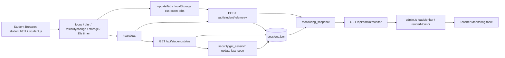

# Historical Telemetry Architecture Audit — Pre-Implementation Baseline

> **Historical snapshot:** the detailed audit below describes the pre-implementation source and its branch at the time. Claims that monitoring, event history, precheck, fullscreen, or Practice locking were absent are no longer current. See [current Architecture](ARCHITECTURE.md), [Exam Monitoring plan](EXAM_MONITORING_IMPLEMENTATION_PLAN.md), and [Known Issues](KNOWN_ISSUES.md).

## Current implementation status (2026-11-22)

The current source has active-attempt telemetry snapshots, persistent per-Student/release event history with counters and sequence paging, a multi-page Student Start precheck, a fullscreen gate, and a Practice lock while that Student has an active Official Exam attempt. These paths are implemented in `app/exam_monitoring.py`, `app/exams.py`, `app/main.py`, and the frontend scripts under `static/js/`. This documentation pass inspected source and test files but did not execute tests or browser checks. The remainder of this document is retained as a historical baseline, not a current implementation report.

## Historical audit: pre-implementation findings

> **Evidence labels below apply only to the historical source snapshot audited in this report.** They must not be read as present-day assertions without checking current source.
>
> **Historical scope:** source on branch `integration/practice-exam`; Exam Monitoring proposals were not implemented at that time.
> **Historical evidence labels:**
> - **VERIFIED CURRENT BEHAVIOR**: xác nhận trực tiếp từ source đang có.  
> - **PROPOSED DESIGN**: quy trình Exam-scoped do Owner đề xuất, chưa được triển khai.  
> - **UNVERIFIED / REQUIRES CONFIRMATION**: source không đủ để khẳng định hoặc cần kiểm thử trên trình duyệt/môi trường chạy thực tế.

## 1. Executive Summary

### VERIFIED CURRENT BEHAVIOR

Student telemetry hiện là **snapshot trạng thái phiên**, được gửi từ `static/js/student.js` tới `POST /api/student/telemetry`. Snapshot gồm `visibility`, `focused`, `tab_count`, `browser` và thời điểm server ghi `updated_at`; backend lưu nó bên trong mục phiên tương ứng trong `sessions.json`. Trình duyệt gửi snapshot lúc khởi tạo, mỗi 15 giây cùng heartbeat, khi focus/blur, khi visibility thay đổi và khi nhận sự kiện `storage`.

Heartbeat chạy cho trang `/` của Student đã xác thực, kể cả khi chưa có bài thi đang chạy. Nó gửi telemetry rồi gọi `GET /api/student/status` để lấy trạng thái Exam/thông báo và phát hiện thay đổi cần reload. Do đó, login không tự gọi telemetry nếu Student chỉ ở trang đăng nhập, nhưng sau khi đăng nhập và tải trang Student, telemetry không đợi Teacher Start hay Student Start.

Heartbeat và telemetry **được ghép trong cùng hàm frontend**, nhưng backend vẫn có điểm tách rõ: `get_session()` cập nhật `last_seen` trên các request xác thực thông thường, còn `POST /api/student/telemetry` ghi telemetry riêng. Vì vậy có thể giữ presence/heartbeat mà ngừng gửi behavioral telemetry bên ngoài Exam, nếu frontend tách hai tác vụ và giữ các request xác thực/status. Hiện tại chưa có cờ hoặc điều kiện Exam để làm việc đó.

Teacher Monitoring gọi `GET /api/admin/monitor`; backend tổng hợp mọi Student từ `students.json`, trạng thái online dựa trên session `last_seen` trong 45 giây, và cảnh báo suy ra từ snapshot mới nhất. Dữ liệu telemetry không chứa Exam ID, Release ID hoặc Assignment ID. Không có lịch sử sự kiện telemetry hay bộ đếm vi phạm bền vững; snapshot mới ghi đè snapshot cũ.

### Đánh giá khả thi

**Exam-only monitoring có thể làm với thay đổi vừa phải** nếu mục tiêu là chỉ cập nhật behavioral snapshot sau Student Start và vẫn duy trì các request presence/status. Phần “ghi nhận sự kiện ban đầu” và hiển thị monitoring theo Exam cần làm rõ mô hình lưu: API hiện tại chỉ thay snapshot theo session, không lưu event history hay khóa theo Exam. Tab precheck có thể tận dụng thuật toán hiện tại nhưng cần truyền đạt chính xác rằng nó chỉ đếm page instance cùng origin có hoạt động gần đây, không phát hiện mọi tab/cửa sổ trình duyệt.

**PROPOSED DESIGN:** lời gọi `POST /api/student/start` hiện là điểm backend authorization/start; chỉ gửi sau khi Student xác nhận tiếp tục để lựa chọn “Đã hiểu” không làm bắt đầu bài. Backend phải kiểm tra quyền lần nữa như hiện nay. Fullscreen phải được yêu cầu từ thao tác click có user activation; trình duyệt có thể từ chối nếu yêu cầu bị trì hoãn qua bất đồng bộ/network. Chưa có fullscreen trong source và cần xác minh riêng trên các browser hỗ trợ.

## 2. Current Data Flow

### VERIFIED CURRENT BEHAVIOR

`sendTelemetry()` tự bắt lỗi của request telemetry rồi trả về; vì vậy lỗi telemetry không ngăn `heartbeat()` tiếp tục gọi status. Tuy nhiên, heartbeat timer hiện vẫn luôn kích hoạt việc gửi telemetry trước request status. Đây là khác biệt giữa **coupling trong lịch gọi** và **khả năng duy trì status/presence khi telemetry thất bại**.

## 3. Verified Implementation Map

| Trách nhiệm | File / function | Trigger | Dữ liệu | Lưu trữ / consumer |
|---|---|---|---|---|
| Khởi tạo trang Student | `app/main.py:284-306`, `Handler.do_GET()` | GET `/` hoặc `/practice` | Session, assignment, Exam state, danh sách Exam đã publish | Render `student.html` hoặc `practice.html`; cả route đều gọi `get_session()` |
| Khởi tạo tracking phía Exam/student shell | `templates/student.html:8-10,91-92` | Render `student.html` | `student.js`, thêm `student-code.js` | Script telemetry chạy trên trang Student chính, bao gồm các state trước khi bắt đầu |
| Tạo tab registry và gửi snapshot | `static/js/student.js:8-35`, `updateTabs()`, `sendTelemetry()` | Khởi tạo và event handlers | Visibility, `document.hasFocus()`, số key tab registry, User-Agent | POST `/api/student/telemetry` |
| Heartbeat/status refresh | `static/js/student.js:37-84`, `heartbeat()` | Ngay khi load, mỗi 15 giây, focus, visibility trở lại | Telemetry rồi status/notifications/Exam state | GET `/api/student/status`; có thể reload trang khi trạng thái thay đổi |
| Event telemetry | `static/js/student.js:76-82` | `visibilitychange`, `focus`, `blur`, `storage` | Snapshot mới nhất | Telemetry API |
| Student bấm bắt đầu | `static/js/student.js:86-101` | Click `#start-exam` | Mật khẩu Exam tùy cấu hình | POST `/api/student/start`; thành công thì reload |
| Nhận thông tin/status Student | `app/main.py:414-420`, `Handler.do_GET()` | GET `/api/student/status` | `assigned`, `started`, Exam/release state, notifications, `published_exams` | `current_exam_for()`, `settings.json`, `notifications.json`, `general_exams.published_for_students()` |
| Xác thực Student Start | `app/main.py:820-825`; `app/exams.py:172-196`, `start_exam()` | POST `/api/student/start` | Student ID, mật khẩu tùy chọn, IP | Đọc `settings.json`, `assignments.json`; đặt `started_at`, `ends_at`, status `in_progress`; audit |
| Lấy code exam cho Student | `app/main.py:419-420`; `app/code_exams.py:471-530`, `get_student_code_exam()` | GET `/api/student/code-exam` từ `student-code.js` | Assignment và release-scoped code exam | Kiểm tra `started_at`, release, status và Paper ref; đọc code submissions |
| Ràng buộc code execution với Exam đang hoạt động | `app/code_exams.py:393-425`, `_active_context()` | Pretest/submit hoặc thao tác cần active context | Exam state, release, assignment, deadline | Từ chối nếu Teacher chưa start, Student chưa start, release không khớp hoặc hết hạn |
| Gửi Student telemetry | `app/main.py:852-863`, nhánh POST trong `Handler.do_POST()` | POST `/api/student/telemetry` | Form fields từ browser | Thay snapshot trong session rồi ghi `sessions.json` |
| Presence/auth session | `app/security.py:36-68`, `new_session()`, `get_session()`, `require_user()` | Login và mọi request dùng `_auth`/session | User, role, IP, UA, created/expiry/last_seen | `sessions.json`; `last_seen` đổi với mọi request session hợp lệ |
| Logout | `app/main.py:511-514`; `app/security.py:99-102`, `logout_session()` | POST `/logout` | Token cookie | Xóa session theo SHA-256 token key khỏi `sessions.json` |
| Tổng hợp Monitoring | `app/main.py:128-178`, `monitoring_snapshot()` | Render Admin Monitoring hoặc GET API | Students, sessions, assignments, submissions | Tính online/alerts và trả snapshot tổng hợp |
| Monitoring API | `app/main.py:335` | GET `/api/admin/monitor` | Snapshot tổng hợp | Chỉ Admin qua `_auth(req,"admin")` |
| Teacher polling và render | `static/js/admin.js:17-49,104-105,235-244`, `loadMonitor()`, `renderMonitor()` | Load trang, nút refresh, timer 5s | `students`, `online_count`, `abnormal_count`, `alerts` | Bảng `#monitor-body` và thống kê |
| Practice visibility handling | `templates/practice.html:127-130`; `static/js/student-practice.js:1354-1365` | Practice page visibility/page lifecycle | Dừng/tiếp tục catalog polling | Không gọi telemetry API; request Practice vẫn xác thực session |
| Telemetry regression test | `tests/test_core.py:102-145` | Unit test | Form có hidden/unfocused/tab_count=2 | Xác nhận ghi session snapshot và monitor tạo 3 alert |

> Dòng được nêu là vị trí hiện tại trong working tree đã kiểm tra. Một số hàm nằm trên cùng một dòng do định dạng hiện có; các số dòng là điểm điều hướng, không phải phạm vi đầy đủ.

## 4. Actual Telemetry Data Contract

### 4.1 Presence, snapshot, events và Exam association

| Nhóm | Hiện có? | Nơi lưu / ý nghĩa |
|---|---|---|
| **Session Presence** | Có | `sessions.json` có entry keyed bằng SHA-256 token; `last_seen` được khởi tạo lúc login và cập nhật khi `get_session()` xác thực request. Teacher xem `logged_in` = session gần nhất có `last_seen` cách thời điểm máy chủ không quá 45 giây. |
| **Current Telemetry Snapshot** | Có | Trường `telemetry` lồng trong session. Mỗi POST thay object cũ bằng object mới; không phải event log. |
| **Historical Monitoring Events** | Không thấy trong schema/route được kiểm tra | Không có bảng/list telemetry event hay counter bền vững. `audit()` có auth/exam events khác, nhưng telemetry route không append event vào audit. `alerts` được tính lại từ snapshot hiện tại. |
| **Exam-scoped telemetry** | Không | Snapshot không mang `exam_id`, `release_id`, `assignment_id`, thời điểm bắt đầu theo Exam hoặc trạng thái Student Start. Việc Teacher Monitoring có dữ liệu assignment cùng hàng không biến telemetry thành dữ liệu được xác thực/scoped theo assignment. |

### 4.2 Field matrix

| Field | Ý nghĩa | Nguồn / chủ sở hữu | Trigger | Kiểu và xử lý backend | Storage / consumer |
|---|---|---|---|---|---|
| `visibility` | Trang Student báo visible/hidden | Client `document.visibilityState`; không phải bằng chứng do server quan sát | Init, heartbeat và visibility/focus/storage events | String; backend chuẩn hóa thành `hidden` nếu đúng chuỗi `hidden`, còn lại thành `visible` | Session `telemetry`; `monitoring_snapshot()` tạo `tab_hidden` |
| `focused` | Client báo kết quả `document.hasFocus()` | Client | Như trên | Form string -> boolean; backend chấp nhận `true/1/on/yes`; mặc định true nếu thiếu | Session snapshot; tạo `window_unfocused` khi false |
| `tab_count` | Số entry còn trong localStorage registry | Client tự đếm; không có xác minh session/server | Mỗi lần `updateTabs()` từ telemetry | Integer form; backend ép trong khoảng 1..20; lỗi parse thành 1 | Session snapshot; giá trị >1 tạo `multiple_tabs` |
| `browser` (telemetry) | User-Agent do browser gửi | Client `navigator.userAgent`; client có thể giả mạo | Mỗi telemetry | String cắt còn 80 ký tự | Session snapshot; trả trong `telemetry`; bảng hiện tại hiển thị `user_agent` session riêng |
| `updated_at` | Thời điểm cập nhật snapshot | Server `utc_now()` | POST telemetry thành công | ISO timestamp giây | Session snapshot |
| `last_seen` | Hoạt động session gần đây, không đồng nghĩa với đang ở Exam | Server qua `new_session()`, `get_session()`; telemetry route cũng cập nhật | Login và mọi authenticated request; telemetry POST ghi lại | ISO timestamp; monitor chọn session có giá trị mới nhất | `sessions.json`; dùng tính online ≤45s |
| `created_at` / `expires_at` | Thời điểm khởi tạo / hết hạn session | Server | Login | ISO và Unix epoch | `sessions.json`; TTL cấu hình 12 giờ trong `app/config.py:17` |
| `ip` / `user_agent` (session) | Client network/browser metadata lúc session | IP lấy từ request khi có; UA header lúc login | Login; IP được refresh khi request có client | UA tối đa 300 ký tự | Session; monitor trả session UA/IP |
| `alerts` | Các nhãn suy ra từ snapshot | Server `monitoring_snapshot()` | Mỗi lần monitor GET/render | Array có `tab_hidden`, `window_unfocused`, `multiple_tabs` | Response Monitor; không lưu lịch sử |
| `logged_in` | Presence gần đây | Server tính từ session `last_seen` | Mỗi lần build monitor snapshot | Boolean, 45 giây | Monitor UI |
| `exam_status`, `started_at`, `remaining_seconds` | Trạng thái assignment đặt cạnh telemetry trong cùng hàng | `assignments.json` và helper exam | Mỗi lần monitor snapshot | Dữ liệu assignment hiện hành | UI contextualizes row; không gắn nguyên snapshot telemetry với một Exam ID |

### 4.3 Ý nghĩa thực tế của `tab_count`

`updateTabs()` dùng `localStorage["css-exam-tabs"]` làm JSON map: mỗi page instance tạo `tabId` ngẫu nhiên trong bộ nhớ, ghi timestamp hiện tại, bỏ entry già hơn 20.000 ms và trả số key còn lại.

Do localStorage được chia theo origin/profile, tín hiệu này là **ước lượng số page instance của ứng dụng cùng origin đã cập nhật gần đây trong browser profile đó**. Nó không chứng minh được số tab chung session, không bao gồm các trang ở origin khác, browser profile khác hay thiết bị khác; cửa sổ và tab đều có thể là page context. Vì key không gắn Student/session/Exam, một tài khoản khác trong cùng browser profile có thể làm tăng số đếm. Đọc-sửa-ghi localStorage không nguyên tử nên hai tab cập nhật đồng thời có thể ghi đè map của nhau. Browser chặn storage cũng làm kết quả kém tin cậy (mã bắt lỗi và tiếp tục).

Tên `tab_count` và nhãn “Nhiều tab” mô tả UI hiện tại, nhưng không mở rộng năng lực kỹ thuật nêu trên. `navigator.userAgent`, focus, visibility và tab count đều là tín hiệu client gửi, không phải chứng cứ độc lập do server xác minh.

## 5. Lifecycle Analysis

### Login

**VERIFIED CURRENT BEHAVIOR:** đăng nhập Student tạo session mới trong `new_session()`, lưu trong `sessions.json` theo hash token. Đăng nhập Student thu hồi các session Student trước đó cùng user trước khi tạo session mới (route login tại `app/main.py:495-510`). Root page xác thực session qua `get_session()` rồi render `student.html`, nạp `student.js`; script gọi ngay `heartbeat()`, nên telemetry bắt đầu gửi sau khi trang đó tải.

Login tại thời điểm user chỉ đang ở trang `/login` không cài listener telemetry; nhưng đăng nhập thành công chuyển sang `/`. Cấu hình session TTL là 12 giờ; request hợp lệ cập nhật `last_seen`.

### Normal Student navigation và Practice

Trang `student.html` có global `student.js`, kể cả khi assignment chưa bắt đầu. Vì vậy snapshot được gửi trước Teacher Start và trước Student Start, trên trang chờ/landing. Khi chuyển sang `/practice`, server render `practice.html` chỉ nạp `student-practice.js`; script này dùng visibility để dừng/tiếp tục **catalog polling**, không gọi `/api/student/telemetry`. Tuy nhiên mỗi Practice API vẫn đi qua auth/session và cập nhật `last_seen`; snapshot cũ trong session vẫn được giữ. Một tab `/` đang mở cùng lúc vẫn tiếp tục gửi telemetry.

Vì monitor giữ snapshot gần nhất mà không kiểm tra tuổi `telemetry.updated_at`, cảnh báo có thể còn hiển thị sau khi Student rời trang Student shell, hoặc sau khi session đã offline, cho tới khi session bị xóa/thay thế hay snapshot mới tới. `logged_in` có freshness threshold; `alerts` hiện không có threshold riêng.

### Teacher Publish / Teacher Start

Teacher Start có hai route theo luồng: route tổng quát cũ `POST /api/admin/start-exam` gọi `start_exam_session()` (`app/main.py:770-774`, `app/exams.py:199-208`); Exam record dùng `POST /api/admin/exam-records/{exam_id}/start`, dispatch tới `general_exams.start_exam()` (`app/main.py:634-640`, `app/general_exams.py:1160-1195`). Với Exam record, `start_exam()` reconcile trạng thái, yêu cầu Exam `distributed`, rồi `_apply_release()` đưa các assignment đã persisted vào trạng thái đang chạy; hàm này ghi `assignments.json` và `settings.json`, chuyển code release sang started. Publish/visibility của Exam là trạng thái phân phối riêng; telemetry frontend không kiểm tra trạng thái này trước khi gửi.

### Student Start và active Exam

`student.js` nút `#start-exam` POST `/api/student/start`; backend gọi `exams.start_exam()`. Backend kiểm tra Teacher đã start, password nếu bật, assignment thuộc release đang hoạt động; nếu đã có `started_at`, trả assignment hiện tại (idempotent theo trạng thái đã bắt đầu). Nếu chưa, ghi server `started_at`, `ends_at`, `status=in_progress`, IP start và audit event. Sau response frontend reload trang.

Với code Exam, GET `/api/student/code-exam` yêu cầu assignment đã có `started_at`, Exam snapshot/release khớp và trạng thái phù hợp. Code execution context còn yêu cầu global Exam state started, assignment thuộc release hiện tại, chưa hết hạn/đóng. Student code workspace tự tải exam và lưu code drafts; source hiện được kiểm tra không đăng ký focus/blur/visibility telemetry riêng. Listener telemetry nằm trong `student.js` của shell.

**Telemetry hiện tại không đổi khi Student Start thành công** ngoài lần gửi định kỳ/event tiếp theo; nó không có field đánh dấu active Exam. Telemetry đã tồn tại trước Student Start.

### Exam End

Exam kết thúc có thể làm Student shell reload/update theo status/state; code exam có thể trở thành read-only và lịch sử code exam vẫn có thể đọc sau khi ended theo `get_student_code_exam()`. Tuy nhiên `student.js` không dừng listener/interval khi Exam ended; telemetry tiếp tục gửi khi shell vẫn hoạt động. Không có xử lý telemetry-specific khi Exam End.

### Refresh, reconnection, browser close

Refresh tạo `tabId` mới; entry cũ còn trong localStorage tới khi quá 20 giây và `updateTabs()` chạy để dọn. Backend giữ snapshot hiện tại trong session cho tới request mới hoặc session bị xóa. Reconnection và status/API request cập nhật `last_seen`; telemetry chỉ cập nhật khi trang `student.js` gửi lại. Không tìm thấy `pagehide`/unload handler trong `student.js` để xóa tab registry hoặc báo browser close. `sessions.json` tồn tại qua server restart theo JSON storage.

### Logout

POST `/logout` gọi `logout_session()`, xóa entry session theo token hash và redirect login. Không có cleanup riêng cho key `css-exam-tabs`; entry sẽ được dọn theo TTL 20 giây khi một trang khác gọi `updateTabs()`. Nếu không có trang nào tiếp tục cập nhật, entry stale vẫn ở localStorage nhưng lần `updateTabs()` tiếp theo sẽ bỏ nó.

## 6. Student Start Integration Points

### VERIFIED CURRENT BEHAVIOR

- Nút và UX “Bắt đầu làm bài” được render tại `templates/student.html:44-48`.
- Click handler hiện tại tại `static/js/student.js:86-101` disable nút, gửi mật khẩu qua POST `/api/student/start`, reload nếu thành công, hoặc toast và enable lại khi lỗi.
- Backend route `app/main.py:820-825` gọi `start_exam()`; `app/exams.py:172-196` kiểm tra Teacher Start/assignment/password và ghi assignment start.
- Student code content được lấy riêng qua `/api/student/code-exam`; `_active_context()` bảo vệ execution/submission routes. Student Start API là authorization/state transition server-side, không frontend-only. Exam record Teacher Start route và Student Start route là hai bước riêng; Student vẫn dùng assignment và `/api/student/start`, không có route Student Start theo từng Exam ID trong handler này.
- Source không có dialog tab-warning hay Fullscreen API call trong Student Start handler.

### PROPOSED DESIGN: vị trí lồng ghép tối thiểu

1. **Tab precheck**: ngay trong click handler trước khi gọi POST start, dùng cùng registry logic hoặc một helper dùng chung. Nếu triển khai precheck độc lập, cần cẩn thận vì gọi `updateTabs()` vừa đếm vừa ghi registry.
2. **Dialog hai lựa chọn**: nếu Student chọn “Đã hiểu”, không gọi `/api/student/start`; giữ nguyên trạng thái server, cho phép thử lại. Không gửi telemetry/event chỉ vì dialog được mở hoặc đóng.
3. **Tiếp tục**: thao tác xác nhận phải là gesture rõ ràng. Recheck backend vẫn thực hiện tại POST như hiện nay để xử lý quyền/state thay đổi trong lúc dialog mở.
4. **Telemetry activation**: sau khi server chấp nhận Student Start, client có thể bắt đầu behavioral telemetry; cần lưu state active/recovery phù hợp qua reload vì handler hiện reload ngay sau thành công.
5. **Initial multiple-tab event**: API snapshot hiện tại có thể nhận trạng thái mới nhất, nhưng không thể lưu event lịch sử; nếu Owner muốn Teacher review sự kiện này theo Exam thì cần xác định cách lưu/event contract trước.

### Fullscreen và race

**UNVERIFIED / REQUIRES CONFIRMATION:** browser thường giới hạn `requestFullscreen()` theo user activation; việc đợi một network response sau click có thể làm mất activation transient. Thứ tự “server Start thành công rồi mới xin fullscreen” có thể bị browser từ chối tùy browser/version. Một thao tác xác nhận riêng có thể là điểm gọi phù hợp về user gesture, nhưng nếu trước đó còn await API thì phải kiểm thử browser thực tế hoặc thiết kế thao tác gesture riêng. Không có fullscreen code hiện hữu để xác nhận khả năng tương thích. Không thuộc phạm vi audit này việc ép buộc thoát fullscreen.

## 7. Feasibility Matrix

| Capability | Existing Support | Required Changes | Complexity | Risks |
|---|---|---|---|---|
| 1. Giữ heartbeat khi ngoài Exam nhưng tắt behavioral monitoring | **Một phần**: auth/status heartbeat có sẵn; telemetry đang gọi cùng `heartbeat()` | Tách `sendTelemetry()` khỏi status heartbeat; chỉ gửi telemetry theo điều kiện Exam | Nhỏ | Tránh bỏ status refresh hoặc làm `last_seen` hết freshness |
| 2. Chỉ bật telemetry sau Student Start thành công | **Chưa hỗ trợ**: telemetry chạy từ trang load trước Start | State frontend phục hồi sau reload; backend authorization vẫn là source of truth; chọn policy cho Exam ended | Vừa | Reload, nhiều tab, session đổi và Exam End có thể làm client state lệch |
| 3. Kiểm tra tab liên quan trước Student Start | **Một phần**: localStorage registry đã đếm page instance gần đây | Tái sử dụng/đưa `updateTabs` thành helper; xác định phạm vi tab và xử lý storage error | Nhỏ đến vừa | Không phải đếm mọi browser tab; không theo Student/session |
| 4. Dialog hai lựa chọn | **Chưa hỗ trợ** | Modal/accessibility, click flow, bảo toàn password/unsaved UX | Nhỏ | Nút “Đã hiểu” phải không gọi start hoặc tạo violation |
| 5. Hủy pending Start khi chọn “Đã hiểu” | **Có thể thực hiện với flow hiện tại** nếu POST chưa xảy ra | Chỉ gọi POST trong nhánh “tiếp tục”; không cần rollback nếu chưa gửi | Nhỏ | Nhiều request/double click cần disable/guard |
| 6. Sau xác nhận, Start và xin fullscreen | Start API có; fullscreen chưa có | Kết hợp gesture, start request, error handling và fullscreen outcome | Vừa | Browser user activation có thể hết hạn; fullscreen có thể bị từ chối |
| 7. Ghi initial multiple-tab event khi vẫn tiếp tục | Snapshot endpoint có, event history không có | Định nghĩa event storage/API hoặc quy ước rõ snapshot; gắn release/assignment | Vừa đến đáng kể | Không được coi telemetry client là chứng cứ; rủi ro mất lịch sử nếu chỉ overwrite |
| 8. Monitoring theo Exam trong Teacher View | Monitor hiện trả mọi Student; assignment context nhưng telemetry không scoped | Thay response/UI filter hoặc thêm trạng thái active Exam/association | Vừa | API/UI redesign tương thích; tránh làm sai counts/alerts hiện hữu |
| 9. Duy trì monitoring sau refresh/reconnect | Backend session + status đã có; telemetry gửi lại khi Student shell load | Phục hồi active state từ assignment/release server response; kích hoạt lại listeners/gửi snapshot | Vừa | Snapshot cũ và tab registry stale; không dùng local-only state làm authorization |
| 10. Không ảnh hưởng Practice | Practice page không gửi telemetry API; auth vẫn cập nhật presence | Tách presence và behavior; giữ Practice API độc lập | Nhỏ đến vừa | Student shell và Practice nhiều tab cùng origin có thể tác động tab registry hiện tại |

Các cấp độ là ước lượng dựa trên số module/contract cần phối hợp, không phải cam kết thời gian.

## 8. Risks and Compatibility

### 8.1 Presence không đồng nghĩa monitoring

Tắt behavioral telemetry không được tắt các request authenticated: `get_session()` cập nhật `last_seen` cho cả status, Practice, Exam APIs. Nếu frontend bỏ toàn bộ heartbeat thay vì chỉ bỏ POST telemetry, online/offline indicator và status/notification/reload behavior sẽ thay đổi. Nên phân biệt hai trách nhiệm trong thiết kế tương lai.

### 8.2 Dữ liệu không được gắn Exam

Teacher Monitor ghép current telemetry snapshot của latest session Student với assignment hiện tại, nhưng snapshot không mang Exam/release IDs. Nếu Student đổi assignment/release, snapshot cũ có thể được hiển thị cạnh assignment mới; không thể chứng minh snapshot xảy ra trong Exam đó. Multi-session logic chọn session có `last_seen` mới nhất; login route hiện thu hồi session Student cũ cùng ID, nhưng các trường hợp cùng browser profile / nhiều tabs vẫn chia sẻ một session.

### 8.3 Tín hiệu không đủ kết luận hành vi

- Focus/visibility được browser gửi, thay đổi vì nguyên nhân bình thường như chuyển cửa sổ hoặc notification.
- `tab_count` là registry localStorage same-origin, không phải browser inventory.
- User-Agent và toàn bộ form telemetry đều có thể giả mạo bởi client.
- Không có server-side tamper validation, event chain, per-exam counter hay history.
- Snapshot staleness không được filter riêng; alert có thể kéo dài sau tab close.
- Browser privacy settings/storage restrictions, multiple profiles/devices, race giữa localStorage writes ảnh hưởng reliability.

Không nên coi riêng một tín hiệu là bằng chứng misconduct hoặc tự động áp penalty.

### 8.4 Exam lifecycle và Student access

Backend Student Start hiện là điểm kiểm soát thực: yêu cầu Teacher đã start, assignment thuộc release hiện tại, password nếu bật. Content/API code exam cũng kiểm tra started assignment/release và deadline. Precheck là UI trước request; quyền phải tiếp tục được kiểm tra ở backend vì lifecycle có thể đổi trong khoảng modal đang mở.

### 8.5 Practice và UI compatibility

Practice template không nạp `student.js`, nhưng Practice authenticated requests vẫn cập nhật session presence. Không nên biến Practice visibility polling thành Exam telemetry. Monitor API response hiện cấp `students`, `online_count`, `abnormal_count`, từng row `telemetry`, `alerts`, exam/assignment fields; redesign Teacher Monitoring cần giữ hoặc đồng bộ contract với `admin.js`. Template hiện có legend nói “Chỉ giám sát tab thi hiện tại” (`templates/admin.html:120-121`), nhưng source backend hiện không giới hạn telemetry theo tab/Exam. Đây là bất nhất giữa copy UI với implementation; report chỉ ghi nhận, không sửa.

### 8.6 Storage và restart

`sessions.json` là persistent JSON, không phải ephemeral in-memory-only state. `storage.py` dùng khóa process-local và atomic file replacement; điều này bảo vệ thao tác trong process hiện tại, không tạo telemetry event store hay multi-process consistency. Logout/xóa session xóa snapshot cùng session; restart không tự xóa sessions JSON. Browser localStorage registry sống độc lập với server session lifecycle.

## 9. Recommended Minimal Implementation Plan

**PROPOSED DESIGN — chưa triển khai/duyệt chi tiết trong báo cáo này.**

1. Tách một chu kỳ presence/status khỏi behavioral telemetry trong `student.js`; giữ `GET /api/student/status` và authenticated request để duy trì `last_seen`.
2. Xác định trạng thái active Exam từ server assignment/release và Student Start, không dựa chỉ vào localStorage. Chỉ gửi telemetry snapshot khi server báo assignment đã bắt đầu và còn active theo lifecycle.
3. Thêm tab precheck trước POST start, diễn đạt chính xác “page của ứng dụng cùng origin hoạt động gần đây”; không tuyên bố đếm tất cả browser tabs.
4. Thêm accessible dialog hai action. “Đã hiểu” kết thúc flow mà không POST Start, fullscreen hoặc event; “Vẫn tiếp tục vào thi” gửi start request và dựa vào backend authorization hiện tại.
5. Thiết kế fullscreen cùng browser user activation; xử lý graceful nếu browser từ chối. Kiểm thử trên Chrome/Edge/Firefox mục tiêu.
6. Chốt có cần **current snapshot** hay **historical events**. Nếu Teacher chỉ cần trạng thái hiện tại, mở rộng snapshot tối thiểu với Exam/release association và timestamp server; nếu cần xem event ban đầu qua thời gian, cần event persistence/API riêng và retention policy. Không đánh đồng hai nhu cầu.
7. Mở rộng Teacher Monitor API/UI để hiển thị Student đang làm Exam và trạng thái Exam-scoped, đồng thời giữ presence cho Students ngoài Exam. Giữ tương thích với polling contract hoặc cập nhật đồng bộ.
8. Kiểm thử: login không telemetry behavioral, heartbeat vẫn online; Practice không tạo Exam alerts; dismiss không tạo Student Start; continue có backend authorization; refresh/reconnect phục hồi active Exam; ended exam dừng monitoring; stale/multi-tab states và multiple session behavior; legacy Exams và code/ZIP access không đổi.

## 10. Open Questions

1. Teacher Monitoring có cần **snapshot hiện tại** hay cần **lịch sử event** có thể audit sau Exam? Code hiện chỉ hỗ trợ snapshot.
2. Với “tab count” precheck, Owner chấp nhận chính xác phạm vi phát hiện là same-origin page contexts trong một browser profile, hay muốn chỉ giới hạn theo tab cùng Student session? Cơ chế hiện tại không phân biệt hai khái niệm.
3. Khi Student Start đã thành công nhưng browser từ chối fullscreen, Exam có tiếp tục hay phải có UX retry/abort? Hiện chưa có fullscreen behavior nên source không quy định.
4. Monitoring có dừng ngay tại Exam End hay tiếp tục cho session presence? Proposal yêu cầu monitoring khi đang thi; chính sách snapshot cleanup/retention sau End chưa có.

## 11. Source Reference Index

| File | Điểm đọc | Vai trò |
|---|---|---|
| `static/js/student.js` | `updateTabs()` 8-20; `sendTelemetry()` 21-35; `heartbeat()` 37-84; Student Start handler 86-101 | Tab registry, telemetry, heartbeat/status, nút Student Start |
| `app/main.py` | `monitoring_snapshot()` 128-178; root/Practice routes 284-306; monitor GET 335; status/code-exam GET 414-420; start POST 820-825; telemetry POST 852-863; logout 511-514 | Routes, monitor aggregation, status, telemetry persistence |
| `app/security.py` | `new_session()` 36-42; `get_session()` 44-60; `require_user()` 62-68; `logout_session()` 99-102 | Session lifecycle/presence |
| `app/config.py` | `SESSION_TTL_SECONDS` 17 | Session TTL 12h |
| `app/exams.py` | `persist_distribution()` 149-170; Student `start_exam()` 172-196; Teacher `start_exam_session()` 199-208; end 210+ | Legacy/global release assignment and two-stage Start |
| `app/general_exams.py` | `published_for_students()` 682-689; `assignment_exam()` 691-711; Teacher `start_exam()` 1160-1195; `_apply_release()` 1080-1157 | Published Exam cards, per-Exam Teacher Start and release application |
| `app/code_exams.py` | `_active_context()` 393-425; `get_student_code_exam()` 471-530 | Student access and execution authorization |
| `static/js/student-code.js` | status/load at 131, 394, 725; editor blur 546 | Code workspace retrieval/draft save; no telemetry event listeners observed |
| `static/js/student-practice.js` | Practice visibility/polling 1354-1365 | Catalog polling lifecycle, distinct from telemetry |
| `templates/student.html` | Student home/start controls 8-48; code workspace 59+; scripts 91-92 | Student shell and script inclusion |
| `templates/practice.html` | header and Practice workspace; script 130 | Practice page does not load `student.js` |
| `templates/admin.html` | Monitoring legend/table 120-143 | Teacher Monitor presentation contract |
| `static/js/admin.js` | `loadMonitor()` 17-29; `renderMonitor()` 38-49; polling 235-244 | Monitor API polling and rendering |
| `app/storage.py` | defaults 12-46; `read_json()` 93+; `write_json()` 106+; `transaction()` 110+ | JSON persistence defaults and locking |
| `tests/test_core.py` | `test_student_telemetry_uses_hashed_session_key_and_reaches_monitor()` 102-145 | Verifies telemetry session storage and derived monitor alerts |

### Verification boundary and repository state

- **VERIFIED CURRENT BEHAVIOR:** source and one focused telemetry unit test were inspected; this documentation task did not run tests or browser automation.
- **UNVERIFIED / REQUIRES CONFIRMATION:** browser-specific fullscreen user activation, localStorage behavior under target privacy settings, actual multi-tab races, and any runtime instrumentation not represented in repository source.
- Working tree at audit time: branch `integration/practice-exam`; existing unrelated modifications/untracked files present. `MERGE_HEAD` was not present when checked. This report does not alter or finalize Git history.

