# Paper Draft Revision Design

**Decision gate:** no product code or runtime data changed. This document recommends the smallest model supported by the current evidence and specifies a compatible draft-history option if product owners later approve it.

**User decision (2026-11-15): Model A approved.** The user explicitly approved retaining one current draft per Paper with immutable published versions. This approval does not authorize Model B draft-revision history. The implementation scope consistent with this decision is Paper-card/request isolation under Model A; no draft-history schema or historical-draft APIs are included.

## Recommendation

**Retain Model A for now:** one current mutable draft per Paper ID, with immutable published versions. Fix frontend request/card isolation first. The source does not confirm persistent cross-Paper overwrite, and the observed loss of earlier saved draft states follows the current single-draft model by design. Model B should be adopted only if the product requirement explicitly includes browsing/restoring prior saved drafts. Model C describes creating a new Paper entity for every independent exam paper; that is already how distinct Papers are represented and is not a substitute for revision history within one Paper.

The choice to add draft history is a product decision requiring explicit approval. This is a design proposal only, not authorization to implement it.

## Current lifecycle and target for Model A

```mermaid
stateDiagram-v2
  [*] --> NewPaper
  NewPaper --> DraftSaved: POST creates Paper ID, revision 1
  DraftSaved --> DraftSaved: PUT replaces current draft, revision + 1
  DraftSaved --> Published: Publish snapshots draft, version N, revision + 1
  Published --> DraftSaved: edit/save creates current draft, revision + 1
  Published --> Published: republish creates version N+1; prior versions remain immutable
  DraftSaved --> Archived: archive, revision + 1
  Published --> Archived: archive, revision + 1
  Archived --> DraftSaved: restore archived Paper, revision + 1
```



Preview reads a saved draft or a selected published version. It does not change lifecycle state. The current `revision` is a concurrency counter across Paper mutations, not a historical content identifier. Release/assignment references continue to target immutable published version IDs.

### Model comparison

| Dimension | A. One current draft + published history | B. Immutable draft revisions + current pointer | C. Separate Paper card per independent draft |
|---|---|---|---|
| Complexity | Lowest; matches present record shape | Highest; schema, APIs, history UI, restore, retention, conflict handling | Low per record but duplicates setup and encourages card proliferation |
| UX | Simple editor; past unsaved/past saved draft states cannot be restored | Users can inspect/preview prior saves and recover by creating a new current revision | Users can keep variants as separate cards, but must rename/manage them and cannot naturally treat them as revisions |
| Storage | Current draft plus immutable published snapshots | Grows with every retained draft save; full JSON records can grow quickly | Each Paper repeats metadata/draft and published versions; growth follows number of cards |
| Migration | No migration; current `draft` and `versions` remain | Legacy draft becomes the first revision on write or a virtual current revision; API compatibility needed | No schema migration, but existing cards cannot be safely split into historical drafts because that history is not recorded |
| Concurrency | Existing `expected_revision` protects current record | Same top-level counter plus draft-revision pointer checks; append and pointer update must be atomic | Independent IDs avoid record-level contention, but duplicated variants can diverge and still be confused in UI |
| Compatibility | Exact current API/storage contract | Keep `draft` as compatibility alias for pointed revision; keep published IDs/references intact | Existing IDs remain, but releases still reference a specific Paper/version; replacing card IDs can break references |
| Fit for reported issue | Addresses late UI response through isolation fix, not prior-draft recovery | Adds prior-draft recovery, but does not itself fix late response/card contamination | Appropriate only when users intend distinct independently released Papers |

## Model B proposal if explicitly approved

### Data shape and identity

Keep `papers.json` keyed by existing immutable Paper ID. Add fields inside each record:

```json
{
  "revision": 12,
  "draft_revision_seq": 4,
  "current_draft_revision_id": "<paper-id>:d4",
  "draft_revisions": {
    "<paper-id>:d3": {
      "id": "<paper-id>:d3",
      "sequence": 3,
      "created_at": "UTC timestamp",
      "created_by": "actor id",
      "title": "Draft title",
      "metadata": {},
      "question_ids": ["ordered-question-id"],
      "question_limit": 1,
      "question_filters": {},
      "restored_from_revision_id": null
    }
  }
}
```

The example is illustrative; no production data is to be changed as part of this gate. Revision IDs are Paper-scoped and monotonically sequenced (`<paper-id>:dN`), separate from published IDs (`<paper-id>:vN`). Sequence values never move backward or get reused, including after restore. Revision content includes all saved mutable draft content and its selection metadata in a deterministic shape. Created/updated metadata should include actor and UTC timestamp. Avoid storing rendered Question snapshots in each draft revision unless preview semantics require them; published versions remain the authoritative frozen snapshots.

`current_draft_revision_id` is the only current pointer. For API compatibility, serialize its content as existing `paper.draft`. The persisted `draft` field can either remain a compatibility mirror updated atomically with the pointer or be removed after a separately approved migration; the safer first rollout is to retain it as a mirror and verify both agree. Do not create a second independent source of truth.

### Save, preview, publish, restore

- **Save:** require existing `expected_revision`; also accept `expected_draft_revision_id` (the editor's base pointer). Under one storage transaction, validate both, allocate next sequence/ID, append a new immutable revision, move the pointer, update the `draft` compatibility mirror, increment top-level `revision`, and update timestamps. If the submitted fingerprint is unchanged, return the current revision without creating a duplicate. Use an idempotency key for retry-safe handling of network timeouts if the API can retry a save whose outcome is unknown.
- **Preview current draft:** existing `GET /api/admin/papers/{id}/preview?draft=1` resolves `current_draft_revision_id` and returns that revision. Include `paper_id`, `draft_revision_id`, sequence and Paper revision in the response so the UI can prove what it previewed.
- **Preview historical draft:** additive query such as `?draft_revision_id=<id>` resolves only a revision belonging to that same Paper ID. It is read-only and clearly labeled historical Draft Preview. Reject simultaneous `version_id`, `draft=1`, and `draft_revision_id` combinations that are ambiguous. Never fetch current Question Bank content to replace saved revision IDs silently; preview must state whether it uses current source data or captured snapshot data. If exact historical preview is required, draft revisions need question snapshots, which has additional storage and migration cost.
- **Publish:** publish only the current pointer's revision after matching expected Paper revision/pointer. Create a new immutable published version using the existing `<paper-id>:vN` identity and existing snapshot logic. Store `source_draft_revision_id` on the published version for provenance. Do not change existing exam/release fields; they continue referencing `paper_id` and `paper_version_id`.
- **Restore historical draft:** user selects historical revision `dK`; restore appends a *new* immutable draft revision with copied content and `restored_from_revision_id=dK`, advances the monotonic sequence and current pointer, and increments the Paper concurrency revision. It never edits `dK`, resets the sequence, or changes any published version. The restored draft is then edited/published through ordinary flow.
- **Reload/list:** expose current draft revision ID/sequence and optionally draft revision count. Card identity remains Paper ID; draft revision is content identity within that card.

### Concurrency and async isolation

Server writes must atomically validate `(paper_id, expected_revision, expected_draft_revision_id)`, append revision, and move the pointer. A mismatch returns a conflict with current revision/pointer metadata; never silently rebase or overwrite. Existing process-local `transaction()` is sufficient only for the current single-process server. If multi-process service deployment is introduced, replace/augment JSON locking with cross-process serialization or transactional storage before relying on it.

Frontend requests must independently capture `(paper_id, paper_revision, draft_revision_id, view_generation)`. A returned response can update the active editor only when Paper ID and view generation still match. This guard is required under A as well as B; history does not cure cross-card races.

### Legacy compatibility and migration

- Existing records have `draft` and `versions`, and no draft-revision collection. On read, synthesize a virtual current revision view from `draft` without writing. On first successful save, create `d1` containing the pre-save legacy draft if preserving that prior state is required, then append the submitted state as `d2`; otherwise, to minimize storage, materialize only the submitted state as `d1`. Product approval must choose whether the first migration save preserves the pre-edit draft.
- Do not bulk-rewrite `papers.json` during rollout. Read legacy and new forms; make each new write atomic and idempotent. Keep `paper.draft` in API responses as the pointed content. Validate and log disagreement if a transitional mirror and pointer differ; never guess silently.
- Existing published versions and `current_version_id` are untouched. Existing exam/release/assignment references use `paper_id` plus `paper_version_id`; they must continue resolving exactly as before. A new version may optionally record its source draft-revision ID for provenance, but old versions need not be rewritten.
- Existing legacy tests show records missing `question_limit` and `question_filters` remain readable/editable (`tests/test_papers.py::test_legacy_paper_without_quantity_metadata_remains_readable_and_editable`). Normalize missing revision metadata only in the editor/API view; avoid destructive read-time migration.

### Retention, storage growth and rollback

Start with no automatic pruning if B is approved; silently deleting revisions would defeat recovery. Show/measure record size and revision count, document backup/restore, and introduce an explicit user/admin retention action only after product approval. Any later pruning must preserve the current pointer, every revision referenced by an audit/provenance feature, and all published versions; export/backup must precede deletion. JSON storage serializes the entire Paper map on each write, so unbounded history increases both file size and write cost. Consider a normalized database only if measured growth warrants a separate migration decision.

Roll out in backward-compatible reads first, then writes/pointer, then history UI. For rollback, retain fields and use `draft` mirror as the fallback; do not drop history during code rollback. Take a verified backup before any migration. This design stage performs no migration.

## Test matrix if Model B is approved

| Area | Required checks |
|---|---|
| Identity | Separate Paper IDs receive separate revision namespaces; titles may match without key collision; no revision ID resolves under a different Paper |
| Save | First save, unchanged save deduplication, append sequence, ordered IDs/metadata preserved, current pointer and compatibility `draft` agree |
| Concurrency | Stale top-level revision and stale draft pointer both conflict; simultaneous saves append at most the allowed winner; retry/idempotency does not duplicate a revision |
| Preview | Current and historical draft preview identify exact revision; historical preview is read-only; ambiguous selectors reject; published preview remains unchanged |
| Restore | Restore creates new sequence and provenance; source revision remains byte-for-byte unchanged; repeated restore creates deterministic new history entries per policy |
| Publish | Publish uses current draft pointer; immutable version records source revision; old published versions and release snapshots remain identical |
| Legacy | Legacy record GET without write; first-write conversion policy; old API clients still receive `draft`; absent quantity/filter metadata remains compatible |
| Retention | No automatic deletion; explicit pruning cannot remove current revision or published versions; backups restore history |
| UI isolation | Delay A responses after switching to B for open/edit/preview/save/publish; B remains selected and no response is applied to the wrong editor |

## Approval decisions

1. **Approved:** keep Model A and implement async card/request isolation, with no draft-history feature.
2. If users need recovery of saved-but-unpublished edits, approve Model B and decide whether migration preserves the pre-first-save legacy draft or materializes only the new state.
3. If Model B is approved, decide whether historical draft preview must be a frozen snapshot of Question content or may render against current Question Bank records with a clear warning.
4. Approve the initial no-pruning policy and storage monitoring/backup requirements before retaining every save indefinitely.
5. Model C should be used only when the user intentionally needs distinct Papers for separate exams/variants; do not create a new Paper automatically for each draft save.

**Stop point:** review this audit and design. No implementation or runtime reproduction has been performed.
