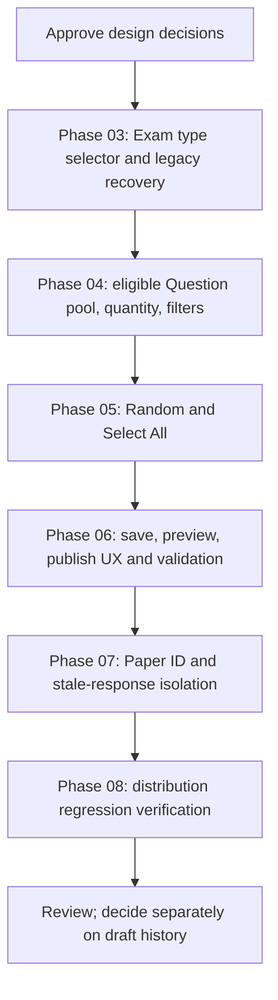

# Implementation Plan — Exam and Paper Management

**Status:** historical design plan. Prompts 03–09 have been implemented or audited in the current working tree, and Prompt 10 produced a scoped acceptance review. This file records the original plan/test matrix, not a statement that every acceptance item passed. See [`../EXAM_PAPER_GUIDE.md`](../EXAM_PAPER_GUIDE.md), [`ACCEPTANCE_REPORT.md`](ACCEPTANCE_REPORT.md), and [`PROGRESS_HANDOVER.md`](PROGRESS_HANDOVER.md) for current behavior and evidence.  
**Baseline:** `feature/JudgeEngine` / `f00a583`; findings and design are in `RE_AUDIT_REPORT.md` and `SOLUTION_DESIGN.md`.

The approved draft model is Model A: one current mutable draft per Paper and immutable published versions. Draft revision history/list/restore remains out of scope. The original phases and test matrix below are retained as design history; items marked planned there must be checked against the current source and final acceptance report.

## 1. Guardrails

- Follow `AGENTS.md`, `IMPLEMENTATION_CONTEXT.md`, and `IMPLEMENTATION_RULES.md` before each phase.
- Keep changes narrow and phase-gated. Do not implement Judge Engine, alter ZIP distribution, rewrite runtime JSON, or introduce dependencies.
- Preserve Paper IDs, Exam release IDs, assignments, submissions and historical snapshots.
- Keep server validation authoritative; client filtering is not an authorization or integrity boundary.
- Do not start a later phase until the current phase is reviewed/authorized.
- At implementation time, inspect current Git state and full diffs; preserve unrelated user changes.

## 2. Proposed phases and lifecycle

Phases 03–07 can be split further if a phase review identifies an API/schema decision. Draft-history storage is explicitly outside this sequence unless approved separately.

### Phase 03 — Exam type exclusivity

**Likely files:** `static/js/exams.js`, `app/general_exams.py`, `tests/` (focused Exam tests; browser test location depends on repository test setup).  
**Work:** add persistent radio/single-choice control; normalize form state to one discriminator; clear inactive serialized configuration; repair malformed both-type hydration explicitly; retain backend one-item checks.  
**Acceptance:** either selection remains changeable; payload emits at most one item; dual legacy data is recoverable without silent data loss; backend rejects malformed publish.

### Phase 04 — Eligible pool, quantity and filters

**Likely files:** `static/js/code-papers.js`, `app/questions.py`, `app/papers.py`, possibly `app/main.py`, `tests/test_papers.py`, question validation tests.  
**Work:** define/reuse the exact eligible pool; normalize optional metadata for filter comparisons; add quantity min/max and AND/OR semantics; preserve selected IDs when filters change; mark nonmatching selections; enforce exact-N at publish with unchanged-legacy-selection compatibility.  
**API choice:** prefer returning the existing list and applying normalized filters in the client initially if question volume permits. If server-side pagination/search is necessary, define query parameters and all-matching behavior before coding. Do not add filtering API speculatively.

### Phase 05 — Random and Select All

**Likely files:** `static/js/code-papers.js`, `app/papers.py` if a server operation is needed, focused Paper tests.  
**Work:** exact-N sampling without replacement; replacement behavior; full filtered-pool select-all; deduplication; partial state/counts; persist ordered explicit IDs so later reads never rerandomize.  
**Acceptance:** page boundaries do not change Select All; insufficient pool disables Random; repeated selection actions remain unique and predictable.

### Phase 06 — Draft lifecycle UX and server validation

**Likely files:** `static/js/code-papers.js`, `app/papers.py`, `app/main.py` only if response/API shape requires it, `tests/test_papers.py`.  
**Work:** dirty/saved revision state; Save Draft for incomplete forms; Preview optional; Publish saves dirty state first and is not gated on preview; exact-N validation on publish; distinguish save failure from preview/publish failure; preserve local data on revision conflict; avoid duplicate publish retries after ambiguous timeout.  
**Storage:** retain the current `draft` object and `versions` array. Add only optional editor metadata if approved; no migration that rewrites existing records.

### Phase 07 — Per-Paper UI isolation

**Likely files:** `static/js/code-papers.js`, browser/UI tests if available, `tests/test_papers.py` for service-level revision behavior.  
**Work:** capture Paper ID, revision and request generation in each asynchronous operation; ignore responses for a different currently selected card; bind save/publish URL to captured target; prevent stale response from replacing current editor; keep stale revision conflict visible and preserve local edits.  
**Acceptance:** delayed load/preview/save for Paper A followed by navigation to B never renders A as B or mutates B's client state. Backend writes remain keyed to the explicit Paper ID.

### Phase 08 — Existing distribution verification

**Likely files:** `app/exams.py`, `app/general_exams.py`, `app/code_exams.py`, `app/submissions.py`, `tests/test_paper_distribution.py` and relevant Exam/release tests.  
**Work:** inspect and run focused existing tests; add only regression tests tied to a verified gap. Check ZIP and Common/Random assignment persistence, exact snapshot identity through retrieval/submission/default regrade, and restart/repeat stability.  
**Out of scope:** replace assignment algorithms or change the opt-in latest-spec regrade behavior without separate approval.

### Optional Phase 09 — Draft history

Only proceed if explicitly approved after evaluating the minimum single-draft implementation. Design immutable draft revision IDs, current pointer, restore-as-new-revision semantics, compatibility reader, storage retention and UI before code. Do not reuse published `version_id` values for draft revisions.

## 3. File responsibility map

| File | Current role / planned touch |
|---|---|
| `static/js/exams.js` | Exam editor state, Code/ZIP controls, payload, autosave, preview/publish; Phase 03 |
| `app/general_exams.py` | Exam item validation and release construction/application; retain invariant and test it in Phase 03/08 |
| `static/js/code-papers.js` | Paper picker/editor, selected order, save/preview/publish and shared async state; Phases 04–07 |
| `app/papers.py` | Paper IDs, CRUD, question validation, revisions, draft preview and immutable publish snapshots; enforce Paper invariants in Phases 04/06 |
| `app/questions.py` | Question validation, lifecycle and list records; normalize optional filter metadata in Phase 04 if approved |
| `app/main.py` | Admin Question/Paper/Exam HTTP routes; only alter for a required, backward-compatible API contract |
| `app/exams.py` | ZIP assignment algorithms and persistence; Phase 08 verification only unless a concrete defect is found |
| `app/code_exams.py` | Code Exam snapshots, assigned Paper retrieval, submission and regrade references; Phase 08 verification |
| `app/submissions.py` | ZIP submission validation/storage against assignment/release; Phase 08 verification |
| `app/storage.py`, `app/config.py` | JSON storage paths/atomic writes/locking; no minimum-scope storage redesign |
| `tests/test_papers.py` | Existing Paper API/service lifecycle and validation tests; extend for new rules |
| `tests/test_paper_distribution.py` | Existing Common/Random snapshot and regrade tests; extend only for gaps |
| `tests/` browser/UI coverage | Determine actual available framework before choosing a test file; no browser test location is assumed by this plan |

## 4. API and storage compatibility plan

1. **Exam payload:** keep existing route and one-item payload shape. Client emits at most one item. Server continues to reject multiple items. Legacy dual-item records are repaired through explicit user choice; no bulk migration.
2. **Question listing:** use `GET /api/admin/questions` and current metadata first. If server filtering/pagination is needed, add optional query parameters without changing current no-parameter behavior. Validate allowed values server-side.
3. **Paper draft payload:** retain `question_ids` as the ordered explicit selection. Add optional `question_limit` and normalized `filters` only with approval; old records lacking those fields remain readable and are not rewritten on read.
4. **Paper update/publish:** retain current Paper-ID routes and revision precondition. Server validates unique IDs, eligibility for new selections, and exact-N publish rule. Return structured field errors and current revision on conflict if compatible with existing error handling.
5. **Published snapshots:** do not mutate `versions`, version IDs, Exam releases, assignments or submission references. Preview and regrade continue to resolve their explicit historical version/snapshot.
6. **Draft history alternative:** if approved later, use a backward-compatible reader that treats the existing `draft` as the current revision, introduce unique draft revision IDs and a pointer, and provide a rollback/backup plan before any migration. No migration is needed for the recommended single-draft scope.

## 5. Test matrix (planned; none run in this phase)

| Area | Cases | Expected result |
|---|---|---|
| Exam type UI | blank, select Code, switch to ZIP, switch back, malformed both-type hydration | persistent control; one active type; repair is explicit; no hidden unrecoverable choice |
| Exam API | zero item draft, one valid item, two items, unsupported item, publish incomplete | draft behavior follows current contract; publish accepts exactly one supported item only |
| Eligible pool | each supported pair; unsupported pair; draft/archived/unpublished; malformed optional metadata | only eligible questions available for new selection; old unchanged snapshot handled compatibly |
| Filters | each dimension; AND across dimensions; OR within tags; case/whitespace; empty filter | predictable result set; no selected IDs silently removed |
| Quantity | min 1, max pool, noninteger, zero, above max, pool shrinks after filter | integer bounds enforced; clear notice; no silent selection deletion |
| Random | exact N, pool exactly N, pool below N, repeated action, duplicate source IDs | exact count, unique IDs, replacement semantics, no accidental rerandomization on reload/preview/publish |
| Select All | filtered subset, multiple pages, all pages, zero results, partial selection | every filtered result selected once; quantity adjusted; no page-only false “all” |
| Paper draft | save incomplete, reopen, save failure, successful save then preview failure | draft state persisted when save succeeds; errors distinguished; IDs/order retained |
| Publish lifecycle | publish without preview; dirty save then publish; save failure; publish failure after save; ambiguous timeout | preview optional; publish uses saved revision; no lost edits or duplicate versions |
| Revision conflicts | two editors update same Paper; stale publish; conflict resolution | conflict surfaced; local edits preserved; no blind overwrite/retry |
| Paper isolation | delayed A response after switching to B for load/preview/save; rapid create/list navigation | stale response ignored for B; operations target captured ID; no UI cross-card contamination |
| Published immutability | edit source Question after publish; archive Paper; release and retrieve | published Paper/release snapshots remain unchanged and addressable |
| Distribution | ZIP strategies; Common version; Random pool member; repeated request/restart; submit/regrade | persisted assignment remains stable and points to exact historical snapshot |

At implementation time, first inspect existing test frameworks and fixtures. Add focused tests where supported. Run only authorized tests in the implementation phase and report exact commands/results; this design phase ran none.

## 6. Review and approval checklist

The following product decisions must be approved before implementation:

1. Exam radio control and explicit recovery for legacy records containing both item types.
2. Metadata filter set and AND/OR semantics; whether points range is excluded from the minimum scope.
3. Incomplete draft allowance and exact-N publish requirement.
4. Random and Select All replace existing selection; Select All spans all filtered results, not only the visible page.
5. Compatibility rule for already-selected questions that later become unavailable.
6. Single current draft as the initial implementation; no historical draft restore feature yet.
7. Persist or reset quantity/filter UI settings across editor reopen.
8. Phase order and focused test execution during implementation.
9. Any distribution fix must be tied to a reproducible failure; do not change current assignment/regrade semantics by assumption.

**Stop point:** review this plan and `SOLUTION_DESIGN.md`. No implementation should begin until the requested decisions and phase authorization are provided.

