# Solution Design — Exam and Paper Management

**Status:** design proposal for approval; no product code changed.  
**Source baseline:** `feature/JudgeEngine` at `f00a583`; see `RE_AUDIT_REPORT.md`.  
**Evidence limits:** source and existing tests were inspected; the application and tests were not run. The audit marks the Code/ZIP symptom and Paper-editor race as requiring runtime confirmation where appropriate.

## 1. Recommended scope

Implement a mutually exclusive Exam item selector, Paper question quantity and metadata filters, random/select-all selection, and clearer draft/save/preview/publish behavior. Preserve the existing Paper ID map, single current draft, revision checks, immutable published versions, Exam release assignments and snapshots. Add protection against stale Paper-editor responses. Do not introduce draft-history storage or redesign distribution in the minimum implementation.

The Paper picker will persist the ordered, explicit question IDs chosen by the administrator. Quantity and filter settings guide selection; opening, saving, previewing, publishing, or reloading must never sample again. The server remains authoritative for eligibility, uniqueness, and quantity.

## 2. A — Mutually exclusive Exam type

### UI and state invariant

Replace the conditional pair of checkboxes in `static/js/exams.js` with a persistent radio group (or equivalent single-choice control) for `Code Paper` and `ZIP`. Keep the choice controls visible regardless of selection. Only the section for the selected type is rendered; a selected type can always be cleared by choosing the other type, and the selected section remains reachable.

Represent selection as one discriminator, e.g. `itemType: null | "code" | "zip"`, alongside type-specific configuration. The invariant is:

```text
itemType = null  => code = null and zip = null
itemType = code  => code != null and zip = null
itemType = zip   => zip != null and code = null
```

On transition, preserve the chosen type's configuration only while that type remains active. Switching types clears the inactive type's payload so it cannot leak into serialization. If retaining previous type configuration is desired, store it in separate inactive UI-only drafts and serialize only the active type; this is not the recommended minimum because it adds state and recovery cases.

### Legacy/malformed hydration

`fromExam()` must normalize records with both item types into a recoverable editor state. Do not silently choose a type and publish it. Show a repair message and require an explicit choice. A safe default is no active item selected and preserve a read-only summary of both legacy values until the administrator chooses Code or ZIP. Do not automatically save the repair just by opening the record. On choosing a type, retain only that type's valid configuration; require the administrator to complete any missing configuration.

Records with no item remain unselected and editable. Unknown item types should produce a visible unsupported-data message and require explicit repair.

### Payload and server contract

`toPayload()` emits zero items for an incomplete draft and exactly one item when a type is selected. It must never emit both. Keep server checks in `app/general_exams.py::_normalize_items()` and `_validate_publishable()` authoritative: drafts may be incomplete only if current create/update rules already permit it; publishing requires exactly one valid supported item. Return field-specific validation errors for zero/multiple/unsupported items.

No route or storage migration is required. Existing valid one-item Exam records continue to hydrate. Invalid legacy dual-item records become repairable in the UI but remain unpublishable until repaired.

## 3. B — Question quantity and filters

### Eligible pool

Use the Paper editor's current server result from `GET /api/admin/questions` and apply the existing Paper eligibility rules consistently on both client and server:

1. `status == "published"`.
2. Supported language/grading pairs: Java + reflection, Java + stdio, Python + stdio.
3. Question exists and passes the current question validation required for Paper snapshot creation.

The current service has an important compatibility behavior: previously selected question snapshots may be retained while updating a Paper, even if their source Question is no longer available/published. Do not make an ordinary edit fail solely because an unchanged legacy selection is now unavailable. New selections must satisfy current eligibility. On publish, preserve the existing snapshot warning/skip behavior only if that is the existing contract; the implementation phase must test and document it before tightening validation.

### Metadata-backed filters

Only expose fields confirmed by source:

| Dimension | Source-backed field | Filter semantics |
|---|---|---|
| Language | `language` (required, enumerated) | exact match |
| Grading mode | `grading_mode` (required, enumerated) | exact match |
| Category | `category` (optional, weakly normalized today) | exact match after trim/case normalization |
| Difficulty | `difficulty` (optional, weakly normalized today) | exact match after trim/case normalization |
| Tags | `tags` (optional, weakly validated today) | OR within selected tags; AND with other dimensions |
| Text | `title`, `id`, and tags used by current search | case-insensitive substring search |
| Points | `total_points` (numeric validated/calculated field) | optional range only if product approves; omit in minimum scope |

`status` is not a useful visible filter while the picker only includes Published questions. Do not add filters for unverified attributes. Before treating category/tags/difficulty as structured dimensions, normalize legacy values defensively and add validation to `app/questions.py` while retaining backward reads for missing or malformed optional metadata.

### Quantity and filter semantics

The quantity is an integer `N` with minimum 1 and maximum equal to the number of eligible questions matching current filters. “All” is represented by setting `N` to the filtered pool size; do not allow a value above that maximum. The server validates that the submitted selection contains the required number of distinct eligible IDs for newly selected questions.

Filters combine as follows: AND across language, grading mode, category, difficulty, and text; OR within multiple selected tags; a question must pass every active dimension. Empty filter values impose no restriction.

Changing filters does not remove or reorder selected questions. The UI shows selected questions in a separate panel with a clear count. If selected questions no longer match the active filters, mark them “outside current filters” and leave them selected. If the filtered pool becomes smaller than `N`, lower `N` to the pool size and show a notice; when the pool is empty, set the control to an empty/disabled state, disable random/select-all, and require a valid selection before publish. If reducing `N` would conflict with retained selection, do not silently drop IDs: retain the existing selection and flag the mismatch for explicit user resolution (remove items or increase/adjust filters). This avoids filter changes destroying work.

Drafts may be incomplete: quantity may be unset or selection count may be less than `N`. Save Draft preserves it. Publish requires a nonempty selection and exact `N` distinct eligible IDs, subject to the explicit unchanged-legacy-snapshot compatibility rule above.

## 4. C — Random and Select All

### Random

“Pick random N” samples exactly `N` IDs without replacement from the entire eligible pool matching current filters and replaces the current selected list. It preserves deterministic order after sampling by storing the resulting ordered IDs. If the filtered pool has fewer than `N`, the action is disabled and explains the maximum; it does not silently reduce the requested number. Selection is ID-unique. A future randomize action is an explicit new user action, not an implicit refresh.

### Select All

“Select all filtered results” selects every eligible result matching current filters across the full result set, not merely the current visual page. It replaces the selected list, sets `N` to that count, and updates the quantity maximum. Pagination or lazy rendering is presentation only; the operation uses the full loaded/server-filtered result set. If an implementation introduces server pagination, the API must provide an explicit all-matching selection operation or return all matching IDs; selecting only the visible page must not be labeled Select All.

Repeated random or select-all operations replace, rather than append, to avoid surprising counts and duplicates. If append is later requested, it must be an explicitly named action with deduplication and a documented cap.

### Selection state and persistence

Selected IDs are persisted explicitly and in order. A checkbox is checked when its ID is selected; mixed/partial state applies to a visible group only when some, but not all, matching IDs are selected. Toggling a group checkbox affects the full matching group and preserves selected nonmatching IDs. A count and “outside filters” indicator make this state visible.

Persisted fields should minimally include ordered `question_ids`, requested `question_limit` (N), and normalized filter settings if the team wants to reopen the builder with its prior controls. The ordered IDs are canonical; `question_limit` and filters are editor metadata and must never trigger re-randomization. On load, show exactly the saved IDs/order. On preview and publish, the server reads the submitted explicit IDs and snapshots those IDs in order.

## 5. D — Draft lifecycle

### User-facing states

Show `New / Unsaved`, `Draft saved` with timestamp/revision, and `Unsaved changes`. Save Draft is available for incomplete work. Preview is optional and reflects the saved draft after a save succeeds. Publish is available without preview, subject to validation; if dirty, Publish first saves the current draft and only then requests publication.

Keep the existing optimistic revision contract. Each update and publish carries the revision last loaded/saved. A stale revision returns conflict and must not overwrite server data. On conflict, retain the local edits, show that the server draft changed, and offer reload/compare/reapply; do not automatically retry with the newer revision.

### Lifecycle and partial failures

```mermaid
stateDiagram-v2
    [*] --> NewUnsaved
    NewUnsaved --> DraftDirty: edit
    DraftDirty --> DraftSaved: Save Draft succeeds
    DraftSaved --> DraftDirty: edit
    DraftDirty --> DraftDirty: save conflict / validation error
    DraftSaved --> Preview: Preview requested
    Preview --> DraftSaved: close preview
    DraftSaved --> Publishing: Publish requested
    DraftDirty --> DraftSaved: save succeeds before Publish
    Publishing --> Published: publish succeeds
    Publishing --> DraftDirty: save or publish fails; retain local edits
    Published --> DraftDirty: edit creates a new current draft
```



For a new Paper, create/save must succeed before preview or publish can address it by Paper ID. If draft save succeeds but preview fails, keep the saved revision and show preview failure separately. If save succeeds but publish fails, retain the new saved draft/revision and report publication failure; do not roll back a successful save. If a request times out with unknown outcome, reload the Paper by ID before retrying to avoid duplicate versions. Published versions and release snapshots remain immutable.

Preview must not be a prerequisite for Publish. Preview should not mutate draft or published records except where the existing endpoint explicitly saves first from the UI; separate preview rendering from mutation where practical, while maintaining compatibility with the current save-then-preview route usage.

## 6. E — Paper independence and draft history

### Evidence and recommendation

The audit found no service-level cross-Paper overwrite: Paper records are keyed by UUID Paper ID and mutations address that ID. The editor does have shared module state and async responses without a current-ID/request-generation guard, so a stale response can replace the editor currently shown. This is a confirmed source-level race risk, not proof that storage has been overwritten across Papers.

Minimum approved design: retain one editable current draft per Paper and immutable published versions. Add request-generation and Paper-ID guards to editor loads, preview responses, save completion, and navigation; bind each mutation to the captured Paper ID and revision. Keep Paper cards independent by ID. Do not add draft history absent an explicit product requirement.

### Alternative: immutable draft history

If users require recovery of every saved draft, use immutable `draft_revisions` keyed by revision ID, plus `current_draft_revision_id`. Each revision contains its own ordered Question IDs and metadata. Restore creates a new revision copied from the chosen historical revision; it never rewinds the revision counter or mutates an old revision. Published `versions` remain a distinct immutable concept. This adds storage proportional to edits, requires retention/cleanup policy, schema compatibility and UI history/restore actions. It is not part of the minimum design.

### Identity, concurrency and storage

Continue using `papers.json` top-level Paper ID keys. Add no title-derived or shared storage key. Current draft updates remain guarded by `revision`; every async client operation captures `(paper_id, revision, request_generation)`, and responses update UI only when the current selection still matches. A successful response for an old card may still have completed its server operation on that explicitly named ID; it must never be applied to another card's client state. On stale revision, preserve local edits and request a user-mediated reload/merge.

Backward compatibility: old records with `draft` and `versions` load unchanged. If optional selection metadata (`question_limit`, filters) is absent, derive a safe editor default from the saved ordered IDs and eligible pool; do not rewrite the record on read. Draft-history fields are not introduced in the minimum plan. Existing `version_id` identifiers and Exam/Assignment references remain unchanged.

## 7. F — Existing distribution and snapshots

Do not replace ZIP `compute_assignments()` strategies or Code Paper Common/Random release construction. Verify and, only if a concrete gap is found, fix that release assignment is persisted once per release/student, remains stable through repeat retrieval/restart, and points to the exact Code Exam/Paper version snapshot used by student retrieval, submission, and default regrade.

Keep default regrade bound to historical snapshots. Preserve the existing explicit `use_latest_spec` override unless the product owner separately changes that behavior. Do not confuse selecting a random subset of Questions while building a Paper with assigning an already published Paper to a student.

Distribution checks cover release creation/reconciliation, Common exact version, Random membership in pool, assignment persistence, student retrieval identity, submission metadata, restart/repeated request stability, and default regrade source. No distribution redesign is proposed.

## 8. API and storage impact summary

| Area | Proposed impact | Compatibility |
|---|---|---|
| Exam UI | Single discriminator and persistent radio selector in `static/js/exams.js` | Existing one-item records unchanged; malformed dual-item records require explicit repair |
| Question metadata | Normalize optional category/tags/difficulty in `app/questions.py` if structured filters ship | Read old missing/inconsistent values safely; no bulk rewrite |
| Paper builder | Quantity, filters, random and all-matching selection in `static/js/code-papers.js` | Keep ordered `question_ids` as canonical selection |
| Paper API/service | Validate quantity/eligibility/uniqueness in `app/papers.py`; optionally extend routes in `app/main.py` only if server-side filtering is chosen | Preserve existing endpoints; reject invalid publish requests with field errors |
| Paper storage | Optional draft metadata only; no new IDs/table needed for minimum scope | Existing `{paper_id: {draft, versions}}` records load; no destructive migration |
| Draft history alternative | New immutable draft revision records and current pointer | Requires migration/read fallback, retention policy and explicit approval |
| Distribution | Tests/hardening only if a gap is proven | Existing release IDs, assignments and snapshots retained |

## 9. Decisions requiring user approval

1. Approve persistent radio selection and explicit repair of legacy Exams containing both Code and ZIP.
2. Approve the filter dimensions and combination semantics above, including normalization of category/tags/difficulty.
3. Confirm draft may be saved incomplete while Publish requires exact quantity.
4. Approve Random and Select All as replacement actions; Select All applies to all filtered results across pages.
5. Confirm current selected legacy Questions may remain in unchanged drafts if they later become unavailable, while new selections must be eligible.
6. Approve the minimum lifecycle: one current draft per Paper, optional Preview, save-before-publish, immutable published versions; defer historical draft revisions.
7. Confirm whether optional filter/quantity settings should be persisted alongside IDs or reset on editor open.
8. Approve the implementation order and test matrix in `IMPLEMENTATION_PLAN.md`; keep distribution changes limited to verified defects.

